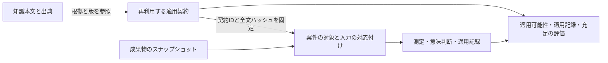

# 適用契約のモデル

この仕様は形式版1の意味を定義します。JSONの構造は[契約スキーマ](schemas/contract.schema.json)と[評価記録スキーマ](schemas/assessment.schema.json)で定義します。構造検査と、ここに定める意味検査の両方を通った記録だけが、有効な判定結果になります。

製品全体のUI/UXを考える場合は、先に[案件の対象範囲と設計判断台帳](product-design.md)で、何を判断する必要があるかを記録します。この仕様は、そのうち適用契約を使う判断の評価を扱います。全判断がデザインシステムや契約の適用であることを前提にせず、未契約の判断を対象範囲から落としません。

## 説明、契約、対応付け、証拠

| 所有物 | 定義するもの | 定義しないもの |
| --- | --- | --- |
| 知識本文 | 概念の意味、背景、適用範囲、原典との対応 | 案件の採否や成功 |
| 適用契約 | 操作的な主張、対象条件、検査範囲、型、要件、証拠の要求 | 案件の実測値や結果 |
| 対応付け `binding` | 契約と成果物の指紋、対象、条件、対象集合、採用の根拠 | 共通知識の変更 |
| 証拠 `evidence` | 取得元と指紋、箇所、方法・実施者、限界 | 証拠だけで導けない結論 |
| 評価 `result` | 問いごとの結果と要件別の根拠 | 契約の範囲を超える品質保証 |

対応付け・観測・意味判断・適用記録・結果は一つの評価記録に保存します。意味上の責務は分け、相互参照はIDで行います。公開APIを実装する場合の入口は `assess(contract, assessmentInputs) -> assessment` の一つです。`assessmentInputs` は結果以外の対応付けと証拠であり、呼出側が書いた合格値を信用しません。

## 契約の来歴と採用

契約の `id` は操作的な主張を識別し、`version` はその条件の版を表します。`schema_version` は形式の版です。本文の版とは独立しています。全ハッシュはUTF-8ファイルのバイト列全体のSHA-256です。JSONを整形し直した場合も異なる指紋になります。

`sources` は概念ID、本文のRepository相対パス、版、全文ハッシュ、見出し、根拠の引用を持ちます。`claim` は契約が検査する主張、`assumptions` は検査モデルを成立させる追加前提、`limitations` は結論を広げられない範囲です。原典の引用は文脈から切り離さず、参照する本文と必要な出典を読みます。

契約の `status` は `example`、`candidate`、`adopted`、`retired` のいずれかです。状態だけを採用許可とみなしません。

| 評価記録のモード | 用途と条件 |
| --- | --- |
| `screening` | 実案件で採用を判断する前に、`candidate` または `adopted` の契約の適用可能性と検査範囲を確認する。採用記録は不要。充足・適用記録の確定は行わない |
| `evaluation` | 採用済み基準に沿って実案件を評価する。`status: adopted` に加え、`binding.adoption` に採用権限者と判断記録の証拠が必要 |
| `illustration` | 説明用の仮定を与えた期待結果。実案件の結果として扱わない |

本文、補足、計算方法など契約の意味が依存する資料は、`dependencies` へパスとハッシュを記載します。依存は空集合でも明示します。本文の更新や依存資料の変更は `stale` となり、再照合を要求します。ハッシュの自動更新を、契約の再採用にしません。過去の成果物と契約のスナップショットをすべて保存した評価は、その過去の版についてのみ再現できます。

## 入力と条件式

`inputs` は入力IDをキーとする表です。各入力は説明と必要な証拠を持ちます。

| 型 | 値 | 意味 |
| --- | --- | --- |
| `boolean` | `true` または `false` | 証拠によって確定した真偽 |
| `enum` | `values` に宣言した文字列 | 有限の分類 |
| `text` | 空文字を含む文字列 | 意味判断に用いる観測済みの内容 |
| `interval` | `lower` と `upper` | 真値を含む閉区間。単位を宣言する |

区間の端点と閾値は、有理数を表す文字列です。整数は `9`、分数は `9/2` と書きます。分母は正整数、分子は整数です。比較は整数の交差積で行い、浮動小数への変換や表示丸めを挟みません。`lower <= upper` を必要とします。計測誤差・計算誤差がある場合はそれを区間へ含めます。真値を囲む根拠がなければ入力は未確定です。

条件式は任意コードや自由文ではなく、次の閉じた式体系です。評価値は真 `T`、偽 `F`、未確定 `U` です。

| 演算 | 形 | 意味 |
| --- | --- | --- |
| 等値 | `eq(input, value)` | `boolean` または `enum` と、同じ型の定数の比較 |
| 下限 | `gte(input, value)` | `interval` と、入力と同じ単位の閾値との比較 |
| 論理積 | `all(args)` | 一つでもFならF、すべてTならT、それ以外U |
| 論理和 | `any(args)` | 一つでもTならT、すべてFならF、それ以外U |
| 否定 | `not(arg)` | TとFを反転し、UはUのまま |

`gte` は下端が閾値以上ならT、上端が閾値未満ならF、それ以外Uです。`all` と `any` の引数は一つ以上必要です。欠落した観測、根拠が不足する観測、相反する観測はUです。未知の演算子、未宣言の入力ID、型違い、未知のenum値、逆転した区間は不正な記録です。Uと不正を混同しません。

入力値を確定するには、成果物の同じ版・対象・条件に結び付いた証拠が必要です。文字サイズの分類や例外の認定にも証拠が要ります。値の自己申告だけでは確定しません。条件式を評価しても、観測方法自体の正しさは証明されません。

観測した空文字は既知の値です。存在する見出しの文字が空の場合も、`has-heading: true` と `heading: ""` で表せます。未観測は観測項目自体を省いて区別します。説明・識別子・判断理由などのメタデータには引き続き空文字を認めません。

## 要件と意味判断

`requirements` は空でない要件集合です。形式版1はすべての要件を必須として扱い、任意要件や点数による平均は持ちません。各要件は一意のIDと、`sources` の参照を持ちます。

`predicate` 要件は条件式を評価します。`judgment` 要件は入力ID、問い、`accept`・`reject`・`unknown` の判断基準を持ちます。レビューには実施者、提案または承認済みの区別、判断理由、対象と証拠を記録します。

意味判断をTまたはFとして使うには、`binding.review_policy` が実施者を明示し、レビューの `authority` が `authorized` であり、判断基準と証拠が対応している必要があります。承認者が未定、AIの提案だけ、複数の承認判断が相反する、必要な文脈がない場合はUです。承認済みの `accept` はT、`reject` はFです。これは記録された意味判断であり、形式証明ではありません。

## 判定の規則

判定は、次の順序と優先関係に従います。

1. 構造・参照・型・ハッシュと、モードに応じた採用条件を検査します。不正または鮮度不一致なら `execution` を `invalid` または `stale` にし、各問いを `undetermined` にします。診断と既存証拠は保持します。
2. `applicability` を評価します。Tなら `applicable`、Fなら `not-applicable`、Uなら `undetermined` です。Fのときだけ充足を `not-applicable` にできます。検査範囲はこの場合 `undetermined` とします。
3. 適用対象のとき `supported_domain` を評価します。Tなら `supported`、Fなら `unsupported`、Uなら `undetermined` です。未対応の背景や計算方法は、知識の適用対象外という意味にはしません。
4. `screening` はここで終了します。`application` は `undetermined`、要件別結果は空配列、充足は適用対象外の場合を除き `undetermined` です。それ以外のモードでは、`applicability: applicable` かつ `support: supported` の対象に限り各要件を評価します。Tは `satisfied`、Fは `violated`、Uは `undetermined` です。
5. 一つでも要件がFなら充足は `violated` です。すべてTなら `satisfied`、それ以外は `undetermined` です。未観測の要件があっても、確定した反例は隠しません。前提が未確定のときは、条件付きの違反候補として診断に残します。

未実施、未対応、入力不足は同じ原因ではありません。`diagnostics` に原因と次に必要な証拠を記載します。処理の実行成功は `execution: valid`、要件の成功は `satisfaction: satisfied` であり、別の値です。

### 適用記録の判定

`application_trace` の各記録は、要件ID、判断対象、行った判断、理由、証拠を持ちます。`binding.adoption` は契約の採用、`application_trace` は要件を判断や変更へ使った証拠です。

`screening` 以外で、`applicability: applicable` かつ `support: supported` であり、全要件に対し成果物の同じ版へ結び付く有効な適用記録がある場合、`application` は `recorded` です。一部の記録がない場合は `not-demonstrated` です。前提や証拠の意味を確定できない場合は `undetermined` です。単に契約を引用すること、読むこと、計算値を添えることは適用記録を満たしません。

### 対象集合と全体への集約

評価記録は一つの対象と一組の条件を評価します。`binding.coverage` は主張する範囲、明示的に列挙した対象集合、列挙の根拠、未確認範囲を持ちます。`binding.target` は必ずその集合の要素です。テーマ、状態、言語、表示幅などは `conditions` に固定します。

画面全体や全状態の主張には、独立した対象列挙の証拠と、対象・条件の直積に対する各評価が必要です。評価済みの対象だけから母集合を作りません。空集合・未確認対象・未確認条件がある場合、全体充足を認めません。契約の全要件で合格しても、概念全体やWCAG全体の充足へ集約しません。形式版1は、この複数評価を集約する記録形式を定義していません。

## 意味検査の境界

JSON Schemaだけで検査できない条件は、評価器の必須契約です。

- 本文のID・版・全文ハッシュ・見出し・引用と、依存資料の指紋が一致する。
- 契約、成果物、証拠の指紋が一致し、参照箇所が存在する。パスは許可したルート内の通常ファイルに限る。
- 契約ID、要件ID、証拠IDが一意で、すべての参照が存在する。異なる版の証拠を流用しない。
- 条件式が入力の型と整合し、値・単位・区間が有効である。JSONに重複キーがあれば読込時に拒否する。
- 対象が列挙集合に含まれ、条件と観測と証拠が同じ対象を扱う。
- 採用とレビューの権限・証拠が有効であり、結果を入力と判定規則から再計算できる。

引用の存在、署名者の名前、ハッシュの一致だけでは、解釈の妥当性や権限の真正性を保証しません。採用時のレビューで確認し、実行環境側が権限と取得元の信頼性を確立します。スキーマに合う自己申告の結果を、検証済み結果として取り込めません。

## 形式化手法への変換

変換単位は知識全体ではなく、契約の要件です。等値、順序、有理数の比較、論理結合からなる `predicate` 要件は、変数の型・値域・単位・対象集合・仮定を固定した論理式へ写せます。変換器はT・F・Uの意味と区間境界を保存する必要があります。

`judgment` 要件は直接変換しません。案件で承認された判断を仮定として渡すことはできますが、証明書には「外部から受け取った仮定」として残します。数値の証明から意味判断の妥当性を導けません。

将来の変換器は、契約・入力・成果物・変換器の版と指紋、論理式、変数対応、仮定、証明範囲、未変換の要件、証明器と版、実行結果を保存します。反例には対象・条件・要件への逆対応を持たせます。証明器の `unknown`、タイムアウト、未対応は証明成功にしません。具体値での評価と、全状態に対する証明を区別します。

形式版1に量化子、状態遷移、時相演算はありません。手順の順序や反復を扱う知識を、完了フラグだけに潰しません。その形式化には、状態・行為・遷移・観測可能性を定義した新しい形式版と検証が必要です。条件が未確定の要件も無理に変換せず、未変換の範囲と理由を返します。

## 設計の選択と実装順序

本文のfrontmatterへ条件を埋め込む案は、説明と操作的な解釈の所有を重ねるため採用しません。関係グラフへ追加する案も、索引の開いた世界の意味と、限定した要件の充足判定を混同するため採用しません。独立したカタログを採用し、参照の鮮度を検査する負担を受け入れます。

独立した設計案を比較し、単一の評価境界と要件別の証拠を持つ案を基本にしました。別案から適用可能性と検査範囲の区別を取り入れました。構造を小さくするために契約と実行結果を同じJSONへ混ぜる案は採用しませんでした。

Foundational Thinkingに従い、説明・契約・対象・証拠の所有を先に定めました。Model the Domainに従い、適用可能性・検査能力・適用記録・充足を独立した状態として表しました。評価器は未実装であり、現在のスキーマ検査を意味検査の代わりにしません。

次の実装単位は、単一の評価器で意味検査とこの仕様の判定を実装することです。その後、同じ要件IDを使う人向け表示とAI向け文書の生成、対応可能な述語の変換器へ進めます。既存の知識本文や関係グラフの移設は不要です。
