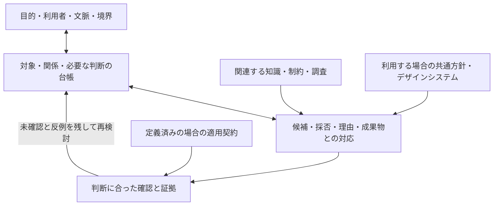

# プロダクト全体のUI/UXを判断する構造

この設計は、プロダクトを構成するUI/UXのあらゆる判断を登録し、目的・文脈・根拠・他の判断との関係・確認結果をたどるためのものです。案件ごとの「設計判断台帳」を入口にします。特定の表現要素や、既存のデザインシステムに該当する判断だけを対象にしません。

台帳はMimicによる操作的な設計です。一般に確立したUI/UXの完全分類、設計工程、万能な評価尺度ではありません。「あらゆる判断を登録できること」と「その製品で必要な判断をすべて発見・検証したこと」を区別します。

## 目的と対象範囲から始める

[ユーザーニーズ](../knowledge/user-needs/KNOWLEDGE.md)は必要な成果と特定の解決案を区別します。[人間中心設計](../knowledge/human-centered-design/KNOWLEDGE.md)と[ユーザージャーニー](../knowledge/user-journeys/KNOWLEDGE.md)は、利用する人、利用状況、利用前後や他の接点とのつながりを扱います。[情報アーキテクチャ](../knowledge/information-architecture/KNOWLEDGE.md)と[インタラクションデザイン](../knowledge/interaction-design/KNOWLEDGE.md)は、情報・機能の意味と構成、操作と応答を扱います。

これらは、共有部品を選ぶ前にも必要になる判断です。[GOV.UK Service Standardのwhole problem](https://www.gov.uk/service-manual/service-standard/point-2-solve-a-whole-problem)は、事前に選んだ技術や解決案より利用者の必要に沿って範囲を定めることを求めます。[across all channels](https://www.gov.uk/service-manual/service-standard/point-3-join-up-across-channels)は、利用者に必要な接点間のつながりを扱います。2026年11月3日に本文を確認しました。英国政府のサービス基準を、全製品への義務として移してはいません。

この図は責務と依存の関係です。工程を一方向に固定しません。目的や対象範囲そのものを問い直す判断も台帳へ登録でき、調査や試作の結果から更新します。

## 対象を閉じた分類にしない

対象は、意味を持つ情報、能力や機能、作業、接点、画面、操作、状態と遷移、文言、感覚的な表現、利用条件などから案件に応じて見つけます。これらは探索の補助例であり、全項目の一覧でも必須分類でもありません。新しい種類や論点を追加できます。

アクセシビリティ、プライバシー、言語、通信環境、信頼や利用者の制御など、複数の対象にまたがる論点は、関連する判断へ結び付けます。見た目の完成後にだけ確認する区分にはしません。一つの固定表を埋めたことを、全UI/UXを考慮した根拠にしません。

台帳の対象は、選択済みの契約・実装済み画面・評価済み項目から逆算しません。製品の目的、利用者と文脈、要求・調査・既存資料を根拠に、含む範囲・除外する理由・未知の範囲を定めます。他の人やシステムへ受け渡す箇所も、その目的に関わるなら含めます。

対象を探索するときは、必要な成果までの行為と接点をたどり、前提、入力、応答、結果、変化する条件、前後への影響を問いにします。要求・調査・既存の仕様・実物の間に対応がない箇所や矛盾があれば、新しい判断や未知の範囲として登録します。これらの問いも固定の完全リストではありません。関連する知識と必要な本文を読み、見つかった関係から対象と問いを更新します。

## 正本と三つの提供形式

| 所有物 | 責務 |
| --- | --- |
| `knowledge/` と出典 | 概念の意味・背景・範囲。案件の採否は所有しない |
| 案件の設計判断台帳 | 目的、対象と関係、判断、採用材料、確認計画と記録への参照 |
| 案件の共通方針・デザインシステム | 採用する場合の再利用する指針・部品・値。その利用をすべての判断の前提にしない |
| `contracts/definitions/` | 定義した範囲の適用・充足条件。契約がない判断も台帳に残す |
| 既存の評価・観察・レビュー・証明の記録 | 実施した確認と限界。台帳に成功値を複製しない |

人向け説明はこの文書、AI向けは[利用手順](agent-guide.md)、機械向けは[設計判断台帳のスキーマ](schemas/product-design.schema.json)と既存の契約・評価スキーマです。同じ判断ID・対象ID・資料の指紋を参照します。各形式で別の対象一覧を作りません。

実案件の台帳は `output/contracts/<project-id>/product-design.json` など案件側で管理します。Mimicには[架空の台帳例](examples/product-design.record.json)だけを置きます。既存の正本や評価結果が別の場所にある場合は、その資料を指紋付きで参照します。

## 台帳のデータモデル

形式版1は、契約形式版1と独立した台帳の形式です。共通のファイルパス・SHA-256の構造は契約スキーマを参照します。

| 項目 | 定義すること |
| --- | --- |
| `id`・`revision`・`schema_version` | 案件台帳の識別、内容の版、形式の版 |
| `product` | 製品と現在考えている目的 |
| `sources` | 資料ID、通常ファイルのパス、全文SHA-256、資料の役割の説明 |
| `goals`・`contexts` | 達成したいことと利用状況。資料に支えられた内容と仮定の違いを記述する |
| `boundary` | 含む範囲、根拠付きの除外、未知、列挙根拠、対象範囲のレビュー状態 |
| `subjects` | 対象ID、開いた種類名、説明と根拠 |
| `relations` | 対象間の方向付きの関係、意味、条件、根拠 |
| `decisions` | 問い、開いた論点名、目的・対象・関係・文脈、採用材料、判断、確認への対応 |

`subjects[].kind` と `decisions[].concerns` は案件の言葉を使う開いた文字列です。特定の視覚要素やUI部品の種類を列挙したenumは持ちません。`relations` は案件の対象間の関係であり、共通知識間の `relations/graph.json` を変更・複製しません。辺がないことを無関係と扱わず、明記した意味を超える逆向き・推移・影響を推論しません。

### 判断と知識の適用

各判断は、何を決めるか、どの目的と文脈に関わるか、対象と関係、参照した材料を持ちます。`resolution` は未決定・選択済み・理由付きの範囲外を区別します。選択済みは、採用案と理由が記録された状態であり、妥当性の検証や権限ある承認の完了とは同義ではありません。

`depends_on` は前提とした判断ID、`outputs` は判断を具体化した仕様・成果物の資料IDです。空配列は、依存や成果物を登録していない状態です。依存の循環がある場合は、相互に確定済みの根拠として扱わず、同時に見直す仮定と未解決事項を明記します。

`materials` は、資料ごとの `use`・`do-not-use`・`undetermined` と、その理由・根拠を持ちます。知識、制約、既存の規則、調査結果などを参照できます。デザインシステムへの参照は任意です。ただし、既知の適用義務や競合を、単に材料から省くことで消してはいけません。

材料の不採用は、その知識や契約が適用対象外であることの証明ではありません。契約の `applicability` は、採用済みの判定規則と対象の証拠で別途評価します。材料の採用も、知識を適用できた記録や成果物の充足を自動的に意味しません。

### 確認の計画と不足

`verification.contract_status` は `mapped`・`unmapped`・`undetermined` です。`mapped` は実在する契約の要件に対応付けた計画がある状態、`unmapped` は対応付けていない状態、`undetermined` は対応付ける契約の選定自体が未確定の状態です。後二者には確定した契約検査を登録しません。対応付けだけでは、契約採用の許可や充足は示しません。

契約がない判断にも確認計画を持たせられます。`checks` は、契約評価、利用者などの観察、レビュー、形式証明の問い・手順・記録への参照を持ちます。これは確認方法の区別であり、UI/UXの分類ではありません。

`checks[].records` が空なら、その確認の実施記録はありません。記録が存在しても成功とは限りません。問い・対象・条件・結果・限界を実際に読みます。契約評価は既存の評価記録を参照し、台帳に `satisfied` を複製しません。契約の参照先に要件が存在するかも照合します。

未契約、未決定、未確認、適用を判断できない状態は、理由と次に必要な確認を残します。「考慮済み」の一つのフラグへ潰しません。[ユーザビリティテストの本文](../knowledge/usability-testing/KNOWLEDGE.md)が区別するように、AIレビュー、自動検査、利用者観察は異なる証拠です。[W3C WAIの参加指針](https://www.w3.org/WAI/planning/involving-users/)も、利用者との確認と標準を組み合わせることを説明します。

## 全体と部分を照合する

対象範囲のレビューでは、目的に必要な仕事や経験が台帳から落ちていないか、想定した人や条件が偏っていないか、除外が正当か、判断同士や受け渡しが矛盾していないかを確認します。未記載の論点は、存在しないと推定しません。

`boundary.review: reviewed` は、根拠と実施者を持つ範囲の見直し記録です。全判断の充足や完全な網羅性の証明ではありません。目的・範囲・資料・依存する判断が変われば、関連する選択と確認の鮮度を見直します。図の配置や対象名の似方から影響先を決めません。

統一感も、見た目の一致だけで扱いません。情報の意味、言葉、行為と結果、状態の伝達、作業の継続、複数接点での期待など、案件が共通に保つことと許す違いを判断へ結び付けます。美的な印象や利用者の理解については、それに合う実物と確認が必要です。

## 意味検査と形式化の境界

JSON Schemaが確認するのは構造です。意味検査では少なくとも次を必要とします。現在、この意味検査を行う本番の評価器は実装していません。

- IDの一意性と、資料・目的・文脈・対象・関係・判断・検査の参照が存在すること。
- 登録した対象や関係に判断が対応しているかを確認し、対応のないものを未検討として示すこと。台帳から自動削除しないこと。
- 資料の指紋と対象の版・条件が一致すること。重複キー、ルート外へのパス、想定外のリンクを拒否すること。
- 論点の対象・関係・文脈が判断の問いと整合し、関連する既存の制約や影響先を隠していないこと。
- 除外・材料の採否の理由と権限を確認し、範囲のレビューが選択済み契約だけに依存していないこと。
- `mapped` に実在する契約参照があり、未契約・未決定・未観測が欠落せず、記録の存在を成功へ変換していないこと。

台帳に状態や遷移の対象を記録できても、それ自体は状態機械の実行や証明ではありません。形式化は、該当する判断の操作的な定義・型・対象・条件・仮定を定めてから行います。意味判断、観察結果、契約の述語、形式証明の仮定を区別します。現在の契約形式にない時相・量化などを使うには、対応するモデルと形式が必要です。

台帳の構造が有効、宣言した対象に判断が対応している、個別契約が充足した、対象者が目的を達成できた、という主張はそれぞれ異なります。未知のUI/UXまで保証する「全体合格」フィールドは設けません。

## 採用した構成

すべての判断を一つの万能な適用契約へ入れる案は、未契約の判断を落とし、契約整備と製品の良さを混同しやすいため採用しません。知識・案件・証拠を一つの巨大なグラフへ統合する案も、それぞれの正本を重ねるため採用しません。

案件の判断台帳を母集合にし、必要な契約と確認を参照する構成を採用します。Redesign From First Principlesに従い、共有定義をすべての判断の必須前提から外しました。Encode Lessons in Structureに従い、開いた対象・論点、任意の材料、明示的な未契約状態をスキーマと例で保持します。
