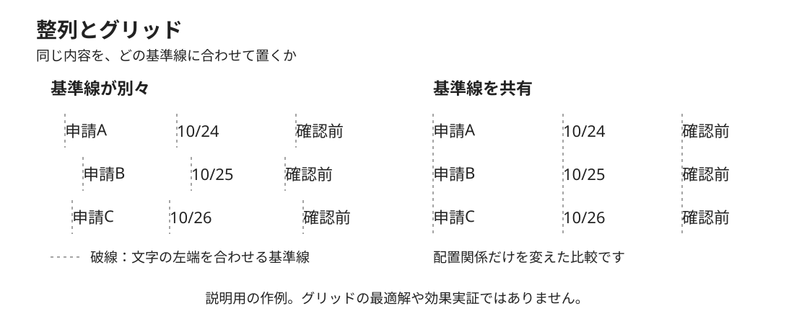

# 一覧の整列の説明例

## 比較するもの

同じ架空の申請一覧を、左は行ごとに別々の基準線、右は列ごとに共有する基準線に合わせて置きます。どの文字の始まりをそろえるかを説明するためのMimicの作例です。Carbonの原典図の転載ではありません。

[説明図を大きく開く（SVG）](./alignment.svg)から、表示と編集に使う図そのものを参照できます。

## 変えることと保つこと

両側に申請A・B・C、日付10/24・10/25・10/26、状態「確認前」を同じ順番で置きます。項目の内容、文字設定、各行の縦の位置は共通です。変えるのは文字の横位置と、それに対応する基準線です。

左側では、申請名・日付・状態の始まりが行ごとにずれています。右側では、申請名の列、日付の列、状態の列のそれぞれで、3行の文字の左端を同じ縦の基準線にそろえています。破線は比較のための補助表示で、製品の画面に必要な罫線を示すものではありません。

要素の周囲にどれだけ余白を設けるかと、同じ種類の内容をどの軸にそろえるかは、別に説明できます。この図は後者を取り出しています。図の列幅や位置を、あらゆる一覧へ適用する推奨値にはしません。

## 説明の範囲

関係する原典は、[Carbonの2x Grid](https://www.carbondesignsystem.com/building-blocks/foundations/2x-grid/overview)の「Columns and Rows」「Key lines」です。図はIBMの8pxや2倍の尺度への準拠を示すものではなく、見た目や理解の改善を測定した結果でもありません。

[整列とグリッドの本文](../KNOWLEDGE.md)では定義と関連概念を、[出典の対応表](../references/sources.md)では原典と説明の範囲を確認できます。
