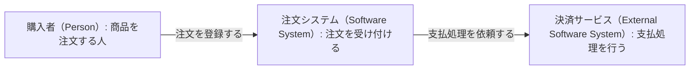
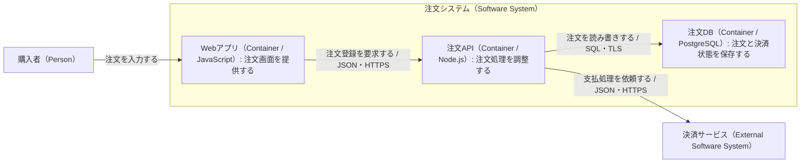

# 注文システムを二つの範囲で見る

[C4モデル](../KNOWLEDGE.md)の抽象度を説明するために作成した架空の例です。
公式サイトの図を再現したものでも、注文システムの推奨構成でもありません。

ここでは購入者が注文を登録し、注文システムが外部の決済サービスへ支払処理を依頼するものとします。
図の名前は、どちらも「注文システム」という同じ対象を指します。
認証、配送、返金などは説明対象に含めていません。

## Context：利用者と外部システム

購入者は注文システムを使い、注文システムは外部の決済サービスへ処理を依頼します。
この図では注文システムの内部を一つの箱として扱います。DBやAPIの所在は説明しません。

凡例：すべての箱はラベルに書いた種類の要素です。
矢印はラベルに記した利用・依頼関係の方向を表し、処理順序、応答、通信方式は省略しています。

## Container：注文システムの内部

次は同じ注文システムを、ブラウザーで動くWebアプリ、注文API、注文DBへ分けます。
Webアプリは注文APIへHTTPSで登録を要求し、注文APIはDBへ保存し、外部の決済サービスへ依頼します。
システムの囲みは管理対象の範囲であり、一台のサーバーを意味しません。

凡例：内側の三要素はC4のContainer、外側の決済サービスは外部システムです。
矢印は要求・アクセスの方向を表します。応答は省略しており、一方向通信しかできないという意味ではありません。
図は責務と通信経路を示し、注文保存と決済の実行順序や同時実行制御は規定しません。

## この例から資料を作るとき

図の冒頭かキャプションに、図名、現状／提案の区別、対象システムの版や確認日を添えると、どの状態を説明しているか追跡できます。
この例の技術名を置き換えるときも、要素の責務と境界が変わっていないか確認します。
「一つの箱を細かく描いた図」と「本番で何台動くかを描いた図」を区別してください。
配置台数やネットワーク境界を説明する場合は、対象環境を指定したDeployment図へ進みます。

上記はMermaidの`flowchart`を使った、C4の観点による簡略表現です。
処理手順を表すフローチャートとしては使っていません。MimicのPagesではソースコードとして表示します。
Mermaid対応エディターなどで図にする場合は、その環境が対応する構文を確認し、ラベルの折返しと囲みをプレビューします。
生成されたことだけでは、抽象度や関係の意味が正しいとは判断できません。

やり取りの順序と状態を説明したい場合は、[注文のシーケンスと状態の例](../../uml/examples/order-lifecycle.md)へ進みます。
