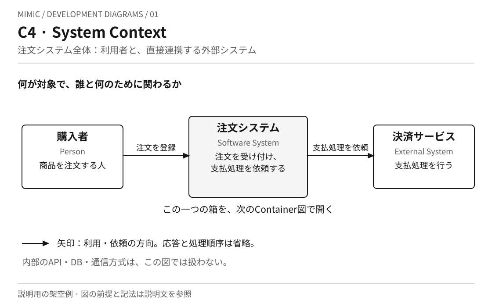
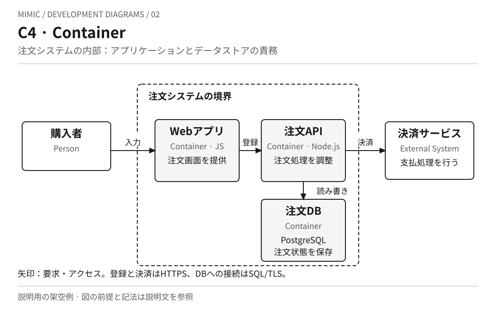
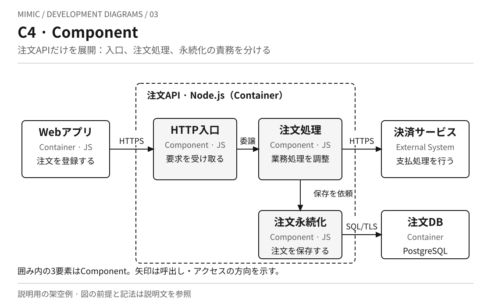
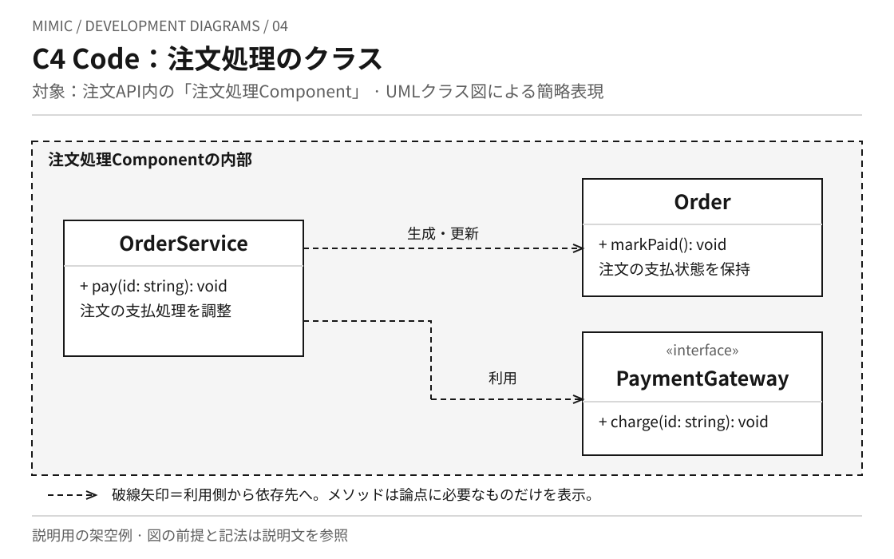
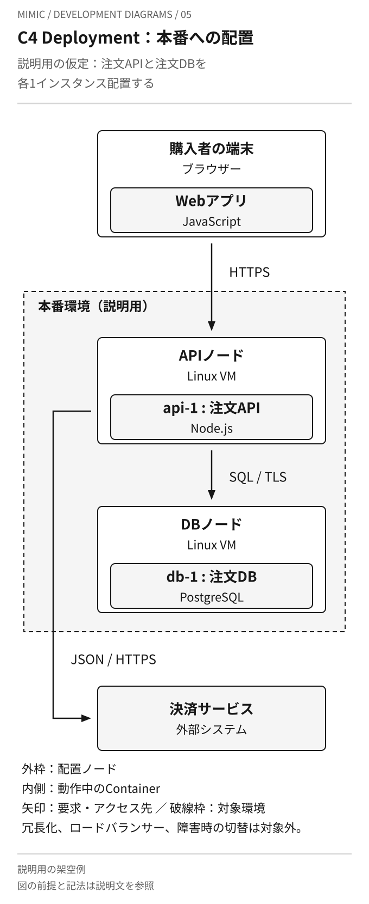
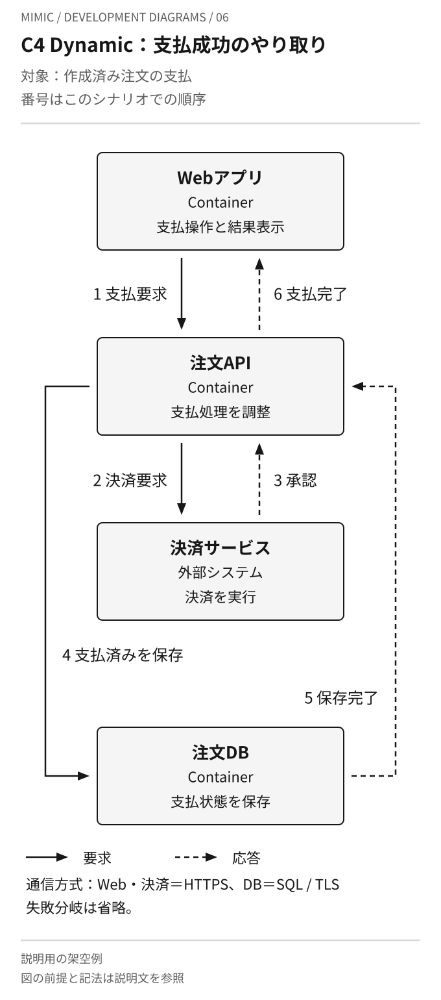

# C4モデルの図を見比べる

[C4モデルの本文](../KNOWLEDGE.md)で紹介した図を、同じ架空の注文システムで描き分けた説明例です。
図はMimicで作成したもので、公式図の複製や、本番システムの推奨構成ではありません。
[注文システムのMermaidソース例](order-system.md)も併せて参照できます。

ContextからCodeまでは対象範囲を絞って静的な構造を見ます。Deploymentは配置する環境、Dynamicは一つの相互作用の順序を補います。
図の箱・囲み・矢印は、それぞれに記した凡例で読んでください。灰色の塗りは見やすさのためで、重要度・稼働状態・性能を表しません。

## 01 · System Context：システム全体と周囲

[画像を開く](c4-context.svg)

**用途：** 対象システムの範囲、利用者、外部との関わりを共有するときに使います。

**読むポイント：** 中央の注文システムは一つの要素です。上下の箱はその内部ではなく、利用者と外部システムを示します。矢印には利用・依頼の目的があります。

**省略範囲：** 内部のアプリケーション、DB、通信方式、処理順序は示しません。

## 02 · Container：アプリケーションと保存先

[画像を開く](c4-container.svg)

**用途：** システム内の大きな責務と、実行・保存単位間の通信を説明するときに使います。

**読むポイント：** 01の中央の箱を開くと、Webアプリ、注文API、注文DBが現れます。破線の囲みはシステムの範囲です。C4のContainerはアプリケーションやデータストアを意味し、Dockerコンテナや一台のサーバーを意味しません。

**省略範囲：** 配置台数、ネットワークの詳細、応答、呼出しの順序は示しません。

## 03 · Component：注文APIの内部

[画像を開く](c4-component.svg)

**用途：** 一つのContainer内部の役割分担と、変更が関わる接点を説明するときに使います。

**読むポイント：** 今回開いたのは02の「注文API」だけです。HTTP入口は要求を受け取り、注文処理が業務を調整し、注文永続化がDBへ保存します。図中のJSはJavaScriptです。この分割は作例の仮定です。

**省略範囲：** 他のContainerの内部、すべてのモジュール、詳細なデータ項目、失敗時の処理は示しません。

## 04 · Code：注文処理を実装する型

[画像を開く](c4-code.svg)

**用途：** 特定Componentの実装上の責務や型同士の依存を検討するときに使います。

**読むポイント：** 03の「注文処理」をさらに開いた図です。OrderService、Order、PaymentGatewayはコード上の型であり、個別に配備するサーバーではありません。区切られた箱と依存の線を、図の凡例に沿って読みます。

**省略範囲：** 全属性・全操作、実装言語ごとの完全な型宣言、通信失敗や永続化の詳細は示しません。

## 05 · Deployment：本番環境への配置

[画像を開く](c4-deployment.svg)

**用途：** どの環境のどの実行場所に、何のインスタンスを置くかを共有するときに使います。

**読むポイント：** 02で示した論理的なContainerと、実行環境にある具体的なインスタンスを区別します。「本番」はこの作例の前提です。同じContainerでも、検証環境では配置が変わり得ます。

**省略範囲：** 冗長化、障害時切替、負荷分散、ファイアウォール設定などは示しません。ここでの一台ずつの配置は可用性を推奨するものではありません。

## 06 · Dynamic：支払成功のやり取り

[画像を開く](c4-dynamic.svg)

**用途：** 一つの機能やシナリオで、要素がどの順序で協調するかを説明するときに使います。

**読むポイント：** 配置された箱の位置ではなく、矢印に付いた番号で順序を追います。静的な構成図だけでは示せない、決済結果を受け取って保存し、完了を返す流れを表しています。

**省略範囲：** 支払拒否、タイムアウト、保存失敗、重複要求、照会処理は示しません。時間の長さや実測値も表しません。分岐を含む別の説明は[注文のシーケンスと状態の例](../../uml/examples/order-lifecycle.md)を参照します。
