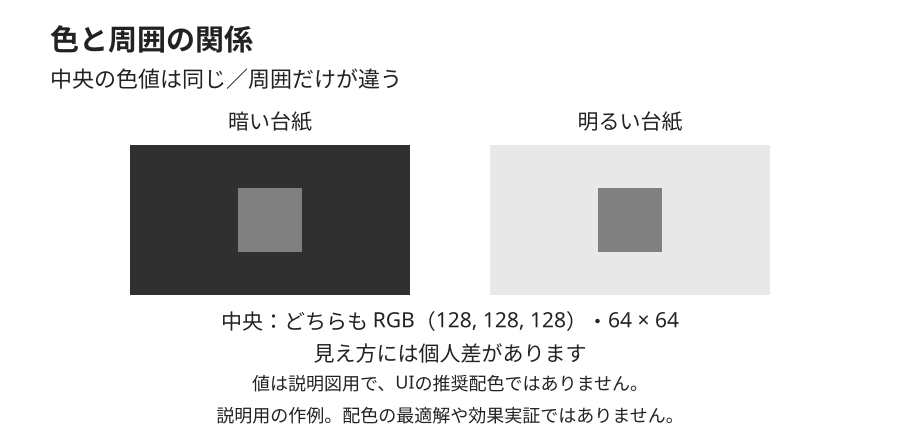

# 周囲の色を変える説明例

## 比較するもの

同じ値の色を、異なる周囲に置いて観察するためのMimicの作例です。中央の小さな正方形を暗い台紙と明るい台紙に置きます。Albersの原典図の転載ではなく、製品UIの色提案でもありません。

[説明図を大きく開く（SVG）](./surrounding-colors.svg)から、表示と編集に使う図そのものを参照できます。

## 変えることと保つこと

二つの中央の正方形は、RGB値と寸法を同じにしています。台紙も同じ寸法とし、それぞれの中央に正方形を置きます。変えるのは台紙の色で、一方を暗く、もう一方を明るくしています。中央の面を別の値に塗り替えた比較ではありません。

見るときは、中央の二つの面がどのように見えるかと、その面に指定した値が同じであることを分けて考えます。特定の見え方を答えとして強制しません。知覚には個人差があり、表示条件も観察に関わります。

## 計算比と観察を区別する

中央の色の値を保っても、組み合わせる台紙の色は異なります。そのため、それぞれの台紙とのWCAGコントラスト比が同じという説明にはなりません。図はコントラスト基準への適合を示すものではなく、見え方の観察と計算比の確認を同一視しないための例です。

## 説明の範囲

[Albers財団の資料](https://www.albersfoundation.org/alberses/teaching/interaction-of-color)にある本人の引用は、色を相対的な媒体として捉える立場を示します。文脈の中で色を観察する教育の説明は財団によるものです。この作例はその論点を説明するために作成しており、推奨配色、配色の調和、見た目の改善を実証しません。台紙と中央の面の値は説明図用であり、製品の正式なToken体系や推奨値として扱いません。

[色の文脈と相互作用の本文](../KNOWLEDGE.md)では定義と対象範囲を、[出典の対応表](../references/sources.md)では本人の言葉と財団の解説の区別を確認できます。
