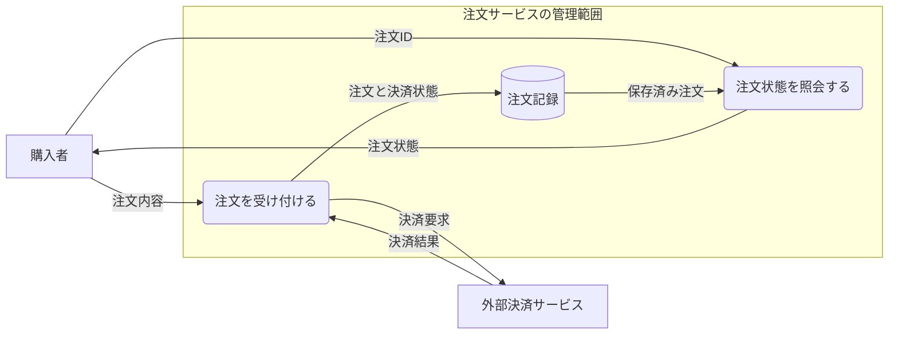

# 注文データの流れと信頼境界

[DFDの本文](../KNOWLEDGE.md)に対応する、Mimicが作成した架空の注文システムの説明例です。
対象は注文の受付・決済結果の保存・結果表示です。配送、返金、再試行の詳細は含めません。

## 図の意味

購入者から届いた注文内容を受付処理が扱い、決済サービスへ決済要求を送ります。
決済結果を受け取った処理は注文記録を保存します。購入者の照会には、保存した情報を読み出して注文状態を返します。
矢印は情報の移動であり、実行順序や完了の保証を表しません。

| 表現 | この図での意味 |
| --- | --- |
| 長方形 | 対象の外部にいる購入者・決済サービス |
| 角丸の箱 | 情報を扱う処理 |
| 円柱 | 注文情報の保存先 |
| 矢印の文字 | 移動する情報 |
| 「注文サービスの管理範囲」の囲み | この例で信頼の前提を分ける範囲 |

購入者の入力と外部決済の応答は、サービス内部の記録と同じ信頼を前提にしない想定です。
囲みをまたぐ箇所で何を検証するかは別の仕様に記載します。この囲みは、正式なDFDの信頼境界記号を再現したものではありません。

## 作成用のソース

次のMermaidコードは、汎用の `flowchart` でDFDの観点を説明する簡略図です。
MimicのPagesではコードとして表示します。対応するMermaid環境で描画でき、図の内容は前節の文章からも読めます。

図からレビューできるのは、入力・保存・外部送信の場所と情報名です。
「決済結果が不明なときに何を表示するか」は、この図だけでは決まりません。
その条件と応答の順序は、[UMLの説明](../../uml/KNOWLEDGE.md)にある振る舞いの図で補います。
