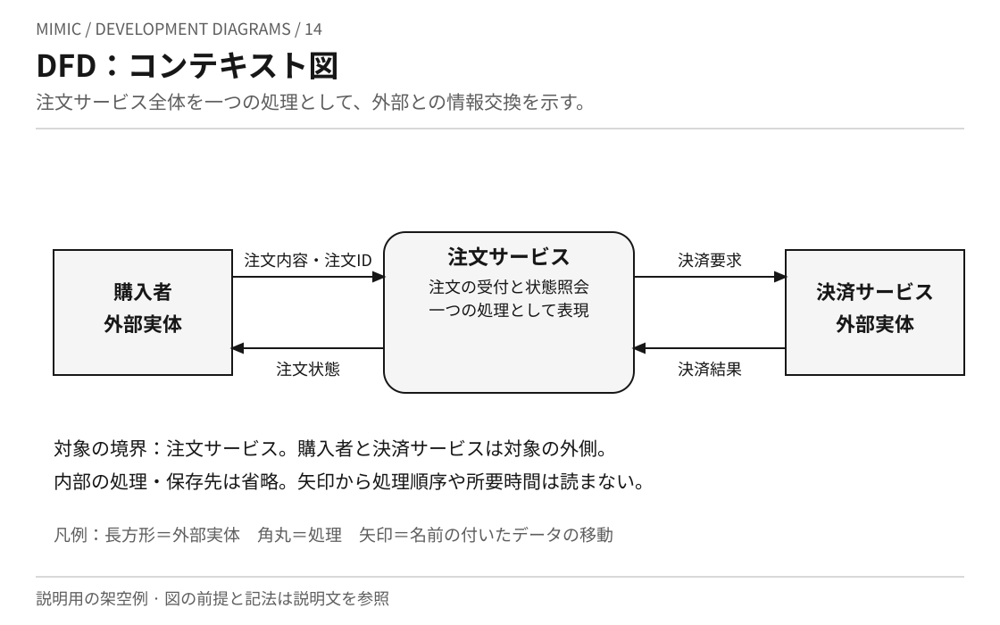
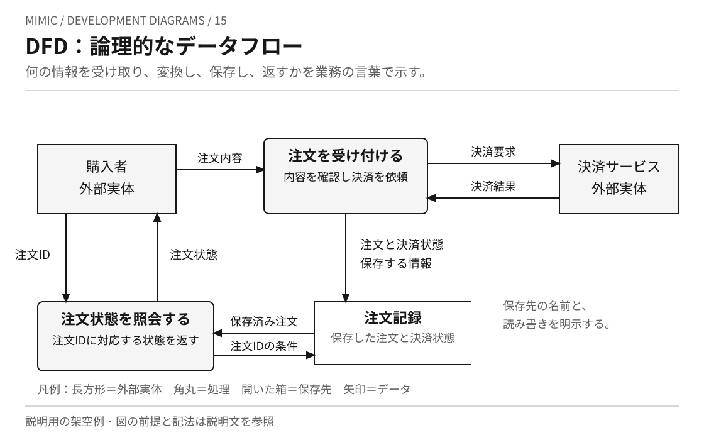
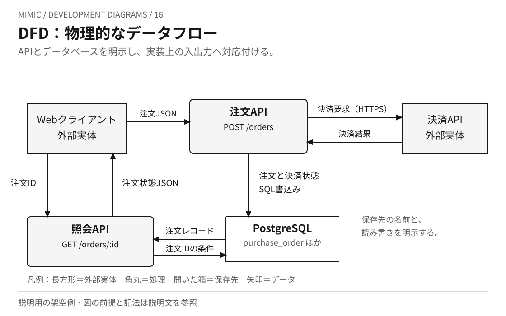
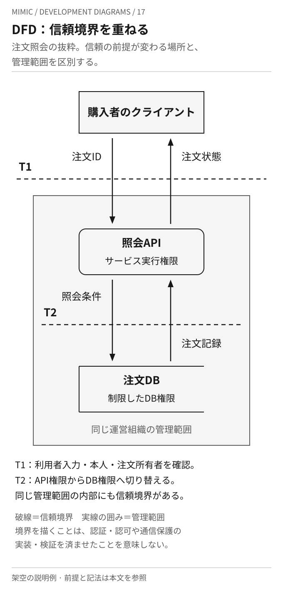

# データフロー図を画像で読む

[DFDの本文](../KNOWLEDGE.md)と[注文データの作成例](order-data.md)に対応する、Mimic作成の説明図です。
同じ架空の注文サービスを、対象範囲・業務・実装・信頼の前提から描き分けます。
各SVGをそのまま開き、拡大して読めます。

全図で矢印は、ラベルに書かれたデータの移動を表します。処理の実行順序、所要時間、成功の保証を表すものではありません。
長方形を外部実体、角丸を処理、右側が開いた箱を保存先とする説明用の記法です。
注文の受付と照会が対象で、配送・返金・再試行の詳細は含めません。

## 14 コンテキスト図

[画像を開く](dfd-context.svg)

用途は、対象システムと外部との情報交換を確認することです。注文サービスの内部構造を説明する前に、誰から何を受け取り、何を返すかを共有できます。
中央の角丸は注文サービス全体を表し、上下の長方形は対象の外側にあります。
この段階では、サービス内部の処理・保存先を分解していません。

## 15 論理的なDFD

[画像を開く](dfd-logical.svg)

用途は、業務上必要な情報の入力・変換・保存・出力を設計することです。
注文受付と注文照会を別の処理として描き、保存する情報と読み出す情報を分けています。
「注文記録」は業務上の保存先であり、具体的なDB製品やテーブル構成は決めていません。
上位のコンテキスト図にある外部との入力・出力は、この図の外部実体につながるフローへ対応します。

## 16 物理的なDFD

[画像を開く](dfd-physical.svg)

用途は、業務上の情報交換を、実装するソフトウェア・データ形式・保存先に対応付けることです。
この例では注文受付を `POST /orders`、照会を `GET /orders/:id`、保存先をPostgreSQLの `purchase_order`・`order_line` 等のテーブルとしています。
これらは説明のために選んだ実装例で、Mimic自体のAPIではありません。
通信方式と保存先が具体的になっても、タイムアウト・トランザクション・障害時の振る舞いは、この図だけでは定まりません。

## 17 信頼境界を加えたDFD

[画像を開く](dfd-trust-boundary.svg)

用途は、データが移動する途中で、どの信頼の前提や権限が変わるかを検討することです。
注文照会に対象を絞り、T1では利用者入力・本人・注文所有者の検証、T2ではAPIからDBへの権限の切替を取り上げています。

| 表現 | この例での前提 |
| --- | --- |
| 実線の囲み | APIとDBは同じ運営組織が管理する |
| T1の破線 | 利用者の入力を、サービス内部でそのまま信頼しない |
| T2の破線 | APIの実行権限とDBアクセス権限を分け、DB側で利用範囲を制限する |

管理範囲は所有・運用のまとまり、信頼境界は信頼の前提が変わる場所です。両者は同じ線になるとは限りません。
破線を引いたことは、認証・認可・通信保護を実装・検証したことを意味しません。
この図のT1・T2は作例の前提であり、実システムでは実際の権限・認証主体に合わせて定義します。
