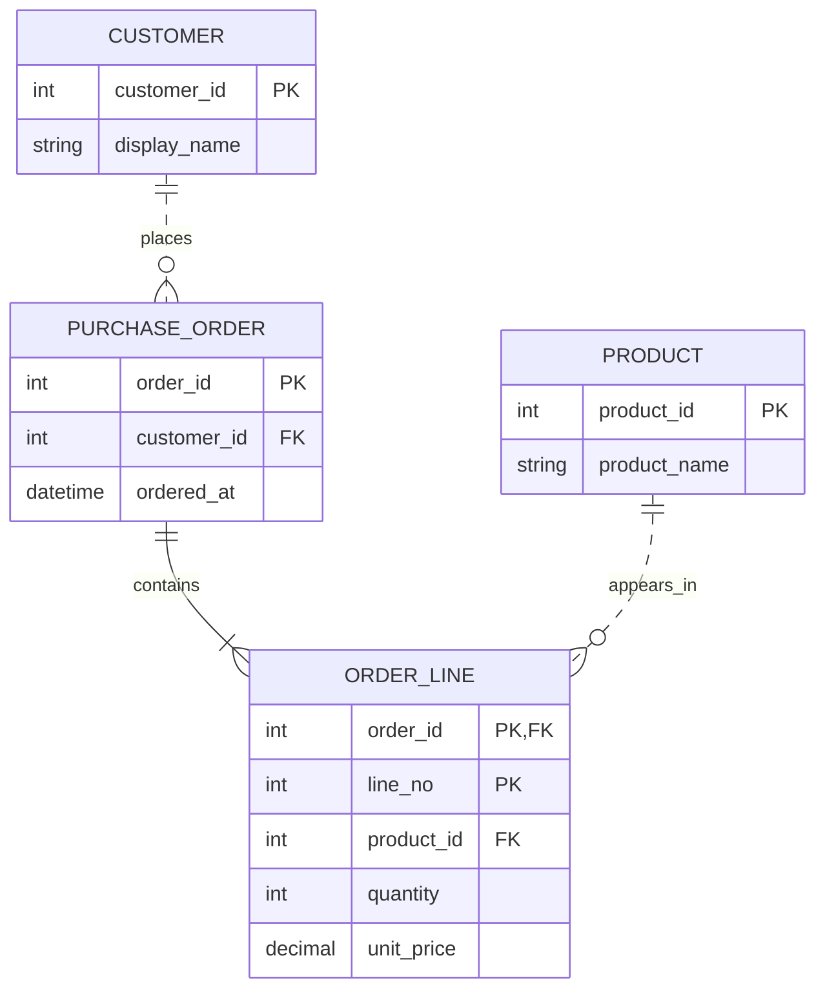

# 注文の関連と多重度を読む

[ER図の本文](../KNOWLEDGE.md)に対応するMimic作成の例です。実在の製品のデータモデルではありません。
架空の注文システムの、リレーショナルDBへの対応を意識した論理モデルを示します。
型名は説明用で、特定DB向けのDDLを完成させたものではありません。

## この例の業務上の仮定

| 関係 | 条件 |
| --- | --- |
| 顧客と注文 | 顧客には注文が0件以上ある。各注文には顧客がちょうど1人いる |
| 注文と明細 | 受付済み注文には明細が1件以上ある。各明細は注文を一つ参照する |
| 商品と明細 | 商品は明細に0回以上現れる。各明細は商品を一つ参照する |
| 明細の識別 | 注文IDと明細番号の組で識別。同じ商品を別の明細番号で含められる |

注文と商品の多対多を、数量と注文時単価を持つ明細で表しています。
`order_id` と `line_no` の二つの `PK` は、各々が一意という意味ではなく、組で一つの主キーです。
注文と明細は識別関係（実線）、顧客と注文・商品と明細は非識別関係（破線）として表します。
ここでは非識別の参照先キーを、参照元の主キーに含めていません。

## 作成用のソース

次のコードはMermaidのER図構文です。MimicのPagesではコードとして表示します。
対応するMermaid環境で描画でき、関係の意味は前節の表からも確認できます。

## 図から実装へ進むときの確認

`customer_id` と `product_id` は、外部キー指定に加えてNULLを許さない条件が必要です。
受付済み注文に明細を一件以上要求する条件は、明細側の外部キーだけでは保証されません。
注文の受付処理と整合性を守る実装で扱う必要があります。

数量の許容範囲、通貨、単価の精度、削除・履歴の扱いは、この図では未定義です。
特に商品名や単価の更新後に過去の注文をどう表示するかは、属性と保存方針を別途具体化します。
この例の線や型の見た目を、完成したDB設計や性能の保証とは扱いません。
