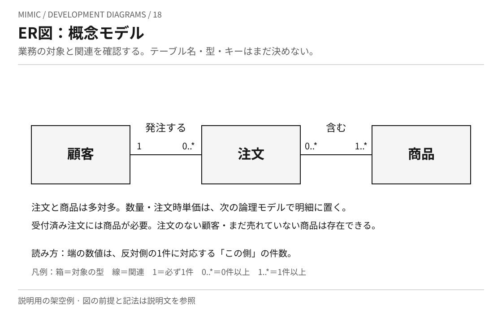
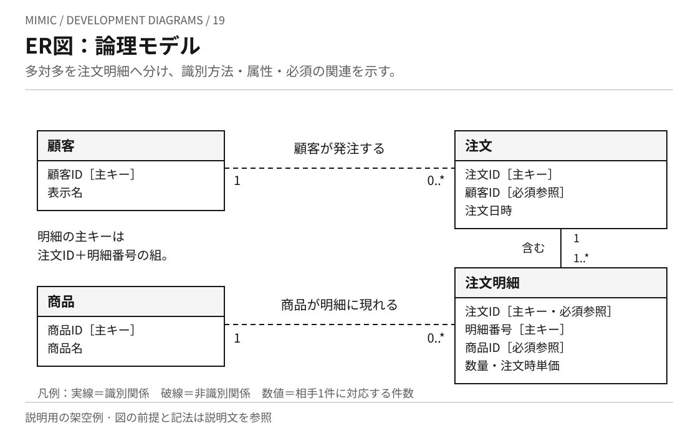
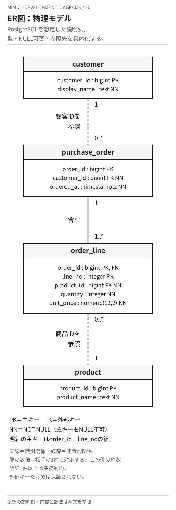

# ER図を画像で読む

[ER図の本文](../KNOWLEDGE.md)と[注文の関連の作成例](orders.md)に対応する、Mimic作成の架空の注文システムの図です。
概念・論理・物理という三つの粒度を、同じ対象で比較します。各SVGを開いて拡大できます。

線の両端の数値は、反対側の一件に対応する、その側の件数です。
`1` はちょうど一件、`0..*` はゼロ件以上、`1..*` は一件以上を表します。
数値表記で多重度と任意性を示す簡略記法であり、線の向きから処理順序は読みません。

## 18 概念モデル

[画像を開く](er-conceptual.svg)

用途は、業務で扱う対象と関連の合意です。顧客・注文・商品の意味を確認し、具体的な型やDBのキーを決める前に対象範囲を共有します。
商品は複数の注文に現れ、注文は複数の商品を含められるため、注文と商品は多対多です。
数量や注文時単価、同じ商品が同じ注文の別明細に現れることは、次の論理モデルで詳しくします。

## 19 論理モデル

[画像を開く](er-logical.svg)

用途は、属性、識別方法、関係の制約を具体化することです。
注文IDと明細番号の組を一つの主キーにするため、同じ商品を異なる明細番号で注文できます。
注文と明細の実線は識別関係、顧客と注文・商品と明細の破線は非識別関係です。
破線は任意の関連という意味ではありません。任意性は数値と属性の「必須参照」で読みます。

| 関係 | 相手の最少・最多件数と必須性 |
| --- | --- |
| 顧客から見た注文 | 0件以上。まだ注文のない顧客も存在する |
| 注文から見た顧客 | ちょうど1人。顧客の参照は必須 |
| 受付済み注文から見た明細 | 1件以上。明細のない受付済み注文を許さない |
| 明細から見た注文 | ちょうど1件。参照する注文IDは主キーの一部でもある |
| 商品から見た明細 | 0件以上。まだ注文されていない商品も存在する |
| 明細から見た商品 | ちょうど1件。商品への参照は必須 |

## 20 物理モデル

[画像を開く](er-physical.svg)

用途は、特定DBで実装・変更する構造を検討することです。図の型はPostgreSQLを想定した説明例です。
DFDの物理図でまとめて示した注文の保存先を、複数テーブルへ分けた場合の主要部分です。
決済状態の保存属性・履歴はこのER図では省略し、注文と商品の関連に対象を絞っています。

| 表記・制約 | この例での意味 |
| --- | --- |
| `PK` | 主キー。`order_line` は `order_id` と `line_no` の組で一意、両方ともNULL不可 |
| `FK` | 外部キー。注文の `customer_id` は顧客、明細の `order_id` は注文、`product_id` は商品を参照する |
| `NN` | `NOT NULL`。参照先が必須の列にも指定する |
| `1..*` の明細 | 受付済み注文が一件以上の明細を持つ業務制約。明細側の外部キーだけでは保証されない |
| `numeric(12,2)` | 説明用に選んだ単価の型。通貨、端数処理、許容値は追加で定義する |

図では主な型・キー・NULL可否を示しています。
数量の許容範囲、削除時の動作、過去の表示用名称の保持、インデックス等は未定義であり、完成したDDLや性能の保証としては扱いません。
