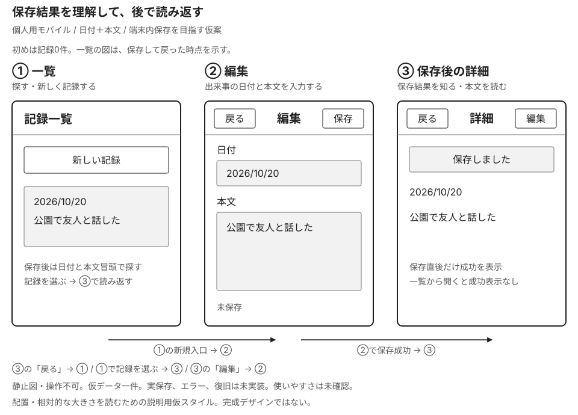

# 記録アプリで全体の判断と資料の粒度をつなぐ

## この例の目的と仮定

「出来事を記録し、後日見つけて読み返す」という利用を通して、どんな判断に、どの程度の資料やデザインを用意するかを説明するMimicの作例です。原典の事例、利用者調査の結果、採用済みの製品仕様ではありません。

個人がスマートフォンで文章を入力し、端末内に保存するアプリを仮定します。記録は出来事の日付と本文を持ち、後から読み直せます。対象OS、事業目的、利用頻度、記録量、同期・共有の要否は未設定です。

七つの段階は[プロダクト全体のUI設計](../../../topics/product-ui-design.md)に合わせた説明上の区切りです。標準工程、必須の承認ゲート、一方向の順序ではありません。「次へ使える」はこの例の次の判断に使えるという意味で、設計の正しさを認定する条件ではありません。

資料の粒度と、デザインの作り込みは別に読みます。

- **資料の粒度**：目的の短文、情報の関係、条件ごとの操作結果など、何をどこまで言葉や図で決めるか。
- **見た目**：役割だけの文字ラフか、実際の配置・文字・部品まで表すか。
- **動作**：静止した説明か、画面を切り替える試作か、実処理を伴う実装か。
- **データ**：仮の一件か、内容量や失敗を含む例か、実際に保存されるデータか。

細かな動作を文章で定めても、見た目を完成させたとは限りません。逆に精巧な画像でも、保存・中断は未再現の場合があります。以下は紙、Markdown、画面試作などで表せる例で、特定の制作ツールを前提にしません。

## 確かめたいことと資料の形式

目的や条件は段落や表で説明できます。画面上の配置を検討するときは、位置・広さ・まとまりが見える図を併用します。文字ラフも要素の順序や大まかな区分を示せますが、実際の画面幅での折返しや、部品同士の距離までを確かめたことにはなりません。

| 確かめたいこと | この例で用意する形式 | その形式だけでは分からないこと |
| --- | --- | --- |
| 誰の何を支え、どんな条件があるか | 目的メモ、概要メモの段落・表 | 情報が画面に収まるか、操作に気づくか |
| 情報の分類や画面間のつながり | 関係図・遷移図と、分岐条件の説明 | 実際の位置・大きさ、操作時の反応 |
| 要素の配置、広さ、相対的な大きさ | 枠と配置を描いた画面図 | 押せると気づくか、処理結果を理解できるか |
| 文字・色・余白と実際の内容の組合せ | 対象環境を想定した画面見本 | 静止画で再現していない操作や状態変化 |
| 文言や操作の流れの理解 | 必要な範囲が動く試作と、利用者による観察 | 再現していない保存・復旧や、対象外の利用条件 |
| 保存、再起動後の復旧など実処理 | 対象環境で動く実装と、条件を定めた確認 | 確認した環境・条件の外でも同じ結果になるか |

この表は形式を選ぶためのMimicの整理です。すべてを順に作る工程ではありません。画面図は画像ファイルに限らず、紙、SVG、HTML、デザインツールなどで表せます。第5節では、同じ内容の段落と[枠・配置のある画面図](recording-app-layout.svg)を比較します。

## 1. 人と目的を理解する

**判断すること**：誰がどんな状況で、何を達成したいのか。機能案を考える前に、調べる問いを絞ります。[人間中心設計](../../human-centered-design/KNOWLEDGE.md)のニーズと解決案の区別につながります。

資料の小例は、調査前の目的メモです。

| 項目 | 記入例 |
| --- | --- |
| 対象と目的の仮定 | 個人が、後で出来事を思い出すために文章を残す |
| 利用場面の仮定 | 出来事の直後に短く入力し、別の日に読み返す |
| 証拠の状態 | 利用者の発言・観察記録はまだない。上の二つは作り手の仮定 |
| 次に聞くこと | 最近何を残し、いつ、何を手掛かりに探し直したか。今はどんな手段を使うか |
| 設計に影響する未知 | 入力量、中断の多さ、日付を覚えているか、機密性、利用上の配慮 |

**粒度と作り込み**：目的と仮定・証拠・問いを区別できる短文でよく、画面はまだなくても構いません。このメモでは動作や保存データは表しません。

**次へ渡せる程度**：誰の何を理解したいかが説明できれば、調査や製品の役割の仮案に使えます。未確認のまま試作する場合も、このメモを仮定の一覧として渡します。例えば長文を後からまとめて書くと分かれば、短時間入力という前提を変えます。

**まだ決めなくてよい細部**：画面数、ボタンの位置、検索部品、色。調査結果を想像で埋めた人物像や感情の曲線も足しません。

## 2. プロダクトの役割を決める

**判断すること**：体験のどこをこのアプリが支え、何を試すか。[ユーザージャーニー](../../user-journeys/KNOWLEDGE.md)の利用前後を含む視点を使います。

製品の役割をまとめた短い概要メモと、将来の利用を仮定した流れを合わせる例です。

| 概要メモの項目 | 記入例 |
| --- | --- |
| 支えたい結果 | 文章を残し、必要なときにその出来事を読み返せる |
| 今回試作する範囲 | 日付と本文の入力、端末内に保存する操作と結果の表現、一覧からの読み返し。実保存は未再現 |
| 今回の試作で扱わないこと | 同期・共有・通知。製品として不要と判断したわけではない |
| 優先する仮の原則 | 入力内容を保つ。保存済みか、次に何ができるかを伝える |
| 成功を確かめる問い | 残した文章を見つけて読めるか。記録件数だけでは判断しない |

```text
出来事が起きる → 残したいと思う → アプリで入力・保存
  → 別の日に思い出したくなる → アプリで探す・読む → 出来事を思い出す
入力中に別の用事が入る → 中断 → 後でアプリに戻り入力を続ける
```

これは観察済みの現状マップではありません。アプリを使っていない期間も含め、支援する範囲を話すための仮の流れです。

**粒度と作り込み**：概要メモと出来事のつながりまで。見た目・動作・データは未制作でも、対象範囲を比較できます。

**次へ渡せる程度**：支えたい結果、今回試す範囲、未知が分かれば、必要な情報を選ぶ材料になります。端末間で読む必要が分かれば、端末内保存だけという範囲を再検討します。

**まだ決めなくてよい細部**：各画面の文言や装飾、未採用機能の全仕様。技術・費用・運用の制約も未確認として残します。

## 3. 情報と仕組みを組み立てる

**判断すること**：何を同じ対象と呼び、どう関係付け、何を手掛かりに探すか。[情報アーキテクチャ](../../information-architecture/KNOWLEDGE.md)とナビゲーションを分けます。

| 用語・情報 | 定義と例 |
| --- | --- |
| 記録 | 保存する一件の出来事。例：日付「2026年10月20日」、本文「公園で友人と話した」 |
| 日付 | 出来事の日付。保存した日時とは区別する |
| 本文 | 利用者が書く文章。独立した題名は今回の仮案にはない |
| 一覧と詳細 | 複数の記録を探す表示と、一件を読む表示。同じ記録を扱う |
| 入力途中の内容 | まだ保存済み記録とは言えない内容。既存記録の編集では元の保存内容とも区別する |

```text
記録の集合
  ├ 記録A：2026年10月20日 + 公園で友人と話した
  └ 記録B：2026年10月18日 + 図書館で本を借りた
```

ここまでは情報の意味と関係です。これに対して「一覧の日付と本文冒頭から選び、詳細を開く」は到達方法の案です。日付の新しい順を仮案としますが、日付以外の手掛かりしか覚えていない人には合わない可能性があります。

**粒度と作り込み**：用語の定義と二件程度の仮データで、一覧と詳細が同じ対象を示すことを表します。見た目は表や関係図、動作はまだ説明だけで構いません。

**次へ渡せる程度**：日付と本文の意味、同じ記録の見せ方、仮の探し方を説明できれば、操作の流れを作れます。内容の一部で探す必要が分かれば、検索や分類の要否をここへ戻って検討します。

**まだ決めなくてよい細部**：データベースの列名、検索方式、一覧行の寸法。少数の例を並べただけでは、大量の記録でも探せるとは分かりません。

## 4. 利用の流れと状態を考える

**判断すること**：操作に何が応答し、戻る・失敗・中断後に何が残るか。[インタラクションデザイン](../KNOWLEDGE.md)の行為と応答を具体化します。

```text
一覧 → 新規の編集 → 保存を開始 → 成功：その記録の詳細 → 一覧
                           └→ 失敗：入力を残して編集 → 再試行
詳細 → 既存記録の編集 → 保存成功：更新した詳細
```

| 条件・状態 | 表示・操作の案 | 保つ内容と行き先 |
| --- | --- | --- |
| 初回で記録がない | 空であることと新規作成の入口を示す | 編集を始められる |
| 編集中 | 日付・本文の変更と保存ができる | 保存前の入力を保持する仮の方針 |
| 保存中 | 処理中を伝え、重ねて保存を開始しない | 入力を保持し、成功・失敗を待つ |
| 保存成功 | 詳細で「保存しました」と伝える | 端末内への保存が確認できた内容を読む |
| 保存失敗 | 保存できなかったことと再試行を示す | 入力を保持。既存記録の元の保存内容も失わない |
| 未保存で戻る | 元の一覧または詳細へ。未保存の入力があることと再開の入口を示す | 再開すると同じ日付・本文へ戻れる案 |
| アプリを離れて再開 | 入力を続けられることを目指す | OS終了・再起動後も復旧できるかは保存方式と実物で確認する |

**粒度と作り込み**：主な流れに加え、この問いに関わる分岐と保持内容まで書きます。文字の画面を切り替え、保存失敗を手動で起こす試作でも、次の操作の理解は調べられます。データは仮で、実保存は未再現と明記します。

**次へ渡せる程度**：成功以外でも表示・選べる操作・残る内容を追えれば、画面の役割と必要要素を考えられます。戻る先に再開の入口が必要だと分かるように、正常な流れだけの図にはしません。

**まだ決めなくてよい細部**：アニメーション、保存方式のコード。再試行で重複を作らないこと、OS終了後の復旧、保存中の中断は、実装へ渡すまでに条件を詰める未決定事項です。

## 5. 画面構成へ落とし込む

**判断すること**：各画面の役割、現在位置、入口と戻り先、必要な情報・操作の関係。まずは構造を読めるラフを作ります。

| 画面 | 役割 | 到達と戻り先 |
| --- | --- | --- |
| 記録一覧 | 記録を探す、新規作成・入力再開へ進む | 起動時の入口。記録を選ぶと詳細へ |
| 記録詳細 | 一件を読む、編集へ進む | 一覧から到達。戻ると一覧の元の位置へ |
| 記録編集 | 日付と本文を入力・修正する | 一覧または詳細から到達。保存成功後はその詳細へ |

### 文章で情報・条件・遷移を説明する

最初は記録のない一覧から「新しい記録」へ進みます。編集画面では「戻る」「保存」、出来事の日付と本文の入力欄、「未保存」を示します。日付に「2026/10/20」、本文に「公園で友人と話した」を入れる仮の一件を使います。

保存成功後は、その記録の詳細内に「保存しました」と表示します。完了専用画面は設けません。詳細から一覧へ戻り、日付と本文冒頭を手掛かりに同じ記録を選んで読み返せます。読み返すために開いた場合は「保存しました」を再表示しない案です。

この段落では、情報の意味、表示条件、行き先を説明できます。入力欄の位置や広さ、要素同士の距離は指定していません。

### 文字ラフで大まかな区分を示す

単色・文字だけの三画面ラフです。区画は役割を示し、実際の色、文字スタイル、余白の値は表していません。三画面はこの例で役割を分けた案で、必要画面数の一般則ではありません。

```text
【記録一覧】             【記録詳細】             【記録編集】
記録                     < 記録一覧              < 戻る     保存
新しい記録               2026年10月20日          日付 [2026年10月20日]
入力途中の記録を再開     公園で友人と話した      本文 [公園で友人と話した]
--------------------     編集                    未保存
2026年10月20日
公園で友人と話した…
```

再開の入口は入力途中の内容がある場合だけの案です。初回の一覧は行の代わりに「まだ記録がありません」と新規作成の入口を示します。保存成功は詳細内で伝える案なので、完了専用画面は設けていません。

**粒度と作り込み**：このラフは情報の順序と経路を比較する粗さです。押す場所をつなぐ試作なら到達方法を試せますが、キーボード、長文の折返し、保存処理までは再現していません。データも短い仮の一件です。

### 画面図で位置と広さを示す



[記録アプリの画面図（SVG）を開く](recording-app-layout.svg)と、同じ一件を使った一覧・編集・保存後の詳細を見られます。図では操作を上部へ、日付を本文の前へ配置し、本文に広い領域を割り当てています。これらは段落だけでは指定していなかった配置案です。

図の一覧は保存して戻った時点、詳細の成功メッセージは保存直後の状態です。再開の入口、保存中・失敗、長文や多数件は図に含めていません。それらの条件は前節の状態表と対応付けて別に考えます。図にないことを、不要という採用判断にはしません。

図の白黒・灰色と文字スタイルは説明用の仮設定です。位置と相対的な大きさを読む静止見本であり、完成デザインや推奨寸法ではありません。操作、実保存、復旧は未実装です。図を見られたことと、利用者が操作や結果を理解できたことは区別します。


図の仮Tokenと値は次の通りです。既存の正式なToken体系ではありません。全色は不透明で、light・通常状態の日本語と英数字を想定します。

| 説明用の仮Token | 値・用途と組み合わせ |
| --- | --- |
| `color.surface.canvas` | `#fff`。図全体、画面枠、ボタンの背景 |
| `color.surface.field` | `#f2f2f2`。入力欄と保存結果の背景。`color.surface.canvas`上で使う |
| `color.text.primary` | `#202020`。本文・見出しと画面枠。上記二つの背景で使う |
| `color.text.secondary` | `#555`。補足の文字。`color.surface.canvas`上で使う |
| `color.border` | `#777`。入力欄の枠と区切り線。上記二つの背景で使う |
| `type.heading` | 20px・700・字間0px・行高1.4。画面名と見出し |
| `type.body` | 16px・400・字間0px・行高1.5。本文と操作名 |
| `type.note` | 14px・400・字間0px・行高1.5。状態と限界の補足 |

文字の基礎Token `type.family.ui` は `-apple-system, BlinkMacSystemFont, "Hiragino Kaku Gothic ProN", "Yu Gothic", Meiryo, sans-serif` です。三役割で共有します。SVGは単行文字を固定座標で配置するため、行高は仮スタイルの説明値です。代替書体、折返しや文字拡大は実表示で別に確認します。

### 文言・状態・動作を具体化する

具体UIや実装へ渡すときは、同じ画面に次のような記述を足します。これは追加で必要になる詳細の小例で、実装仕様一式の完成ではありません。

| 対象 | 文言・表示と動作の記述例 |
| --- | --- |
| 保存中の編集 | 保存の位置に「保存中…」。二度目の保存を開始せず、本文を表示し続ける |
| 保存失敗の編集 | 「保存できませんでした。入力内容は残っています」と「再試行」。同じ内容で保存を試す |
| 保存成功の詳細 | 保存された本文と「保存しました」。端末内の保存成功時だけ表示し、同期・バックアップ完了とは表現しない |
| 戻って再開 | 「戻る」で移った元画面の「入力途中の記録を再開」から、未保存の日付・本文を復元する |

**次へ渡せる程度**：構造を確かめるならラフと経路で試せます。文言と状態の理解を確かめるなら、上の表示・動作も試作に含めます。実装へ渡すには、入力条件、保存中に編集・戻るを選べるか、処理結果の伝達、復旧の範囲などを決め、担当者が結果を読み違えない程度にします。

**まだ決めなくてよい細部**：構造を調べている間の装飾や微細な動き。具体UIの判断に進むときは、対象OS、長文・多数件、文字拡大や読み上げの条件を加えます。見た目を整えた画像だけでは、それらの動作を確認したことにはなりません。

## 6. 共通の判断をガイドに残す

**判断すること**：画面や担当が変わっても引き継ぎたい判断と、その適用条件。[デザインシステム](../../design-systems/KNOWLEDGE.md)との関係を読むため、今回の保存の扱いを短いルールにします。

| ガイドの項目 | 記入例 |
| --- | --- |
| 原則と理由 | 入力内容を保ち、保存済みかどうかを伝える。中断後も続けられることを重視するという本例の仮定による |
| 対象 | 日付・本文を端末内へ明示的に保存する新規作成と編集 |
| ルールと文案例 | 保存成功の確認後に「保存しました」。失敗では未保存を伝え、入力を残して再試行を示す。上の状態例に対応する |
| 適用外・変更条件 | 同期の結果にはそのまま使わない。自動保存に変える場合は状態と文言を見直す |
| 確認範囲 | 色だけで状態を伝えず、文言も添える案。読み上げや文字拡大での利用は実物で未確認 |
| 更新の扱い | 作例v1。実案件では判断する担当と、変更時に確認する画面・実装を指定する。ここでは担当者未設定 |

**粒度と作り込み**：原則だけでなく、条件・文案例・例外・未確認を残します。見た目は共通の役割を示す段階で、色や文字スタイルの具体値はまだありません。動作・データの範囲は参照する状態例と同じです。

**次へ渡せる程度**：別の画面を作る人が、どの条件でこのルールを使い、何が違えば見直すかを判断できれば、共有資料として使えます。失敗例を変えた場合は、ガイドと画面の文言・内容保全の扱いも照合します。

**まだ決めなくてよい細部**：未使用部品を含む網羅的なライブラリ。実際の共通化の必要と、既存の指針・部品の有無を確認してから範囲を増やします。

## 7. 試し、確かめ、更新する

**判断すること**：どの未知を、どんな対象と方法で調べるか。[ユーザビリティテスト](../../usability-testing/KNOWLEDGE.md)に沿って、課題と再現範囲を合わせます。ここまで全部を完成させる必要はなく、問いに必要な部分を試せます。

| 確認したい問い | 課題案・用意するもの | 得られる範囲と限界 |
| --- | --- | --- |
| 記録を見つけられるか | 「以前残した出来事を探して読み直してください」。複数日付と本文の仮データを入れた一覧・詳細ラフ | 探す手掛かりや名称への反応。長期間の大量記録の利用は未再現 |
| 失敗と再試行を理解できるか | 「今日の出来事を残し、後で読めるようにしてください」。失敗と入力保持を再現する試作 | 状況理解と次の行動。指定ボタンを押すようには教えない。実保存の成立は未確認 |
| 中断後に内容を続けられるか | 入力後にアプリを離れ、再開する状況。対象OSで保存・復旧する実装 | OS終了も条件に入れた保持の確認は実装で行う。画面を切り替えるだけの試作では代用しない |

参加する人は想定利用者の経験や利用条件に合わせて選び、同意や記録の扱い、利用上の配慮も計画します。固定人数や一律の合格値は、この例では置きません。

未実施の確認を、結果らしく埋めない記録例です。

```text
対象：一覧から以前の記録を開く試作v1
条件：仮データ。実保存・実機の読み上げは再現しない
観察（行動・発言）：未実施
解釈：未判断
次の判断：日付と本文冒頭で探せるかを観察し、情報構造・一覧を見直す
```

**粒度と作り込み**：問い、対象者の条件、課題、試作の見た目・動作・データの再現範囲、記録する内容までを用意します。ラフを使う問いと、実装や実機を要する問いを分けます。

**次へ渡せる程度**：実施後は観察、解釈、変更案、次に確かめる問いを分けて渡します。例えば探す手掛かりが仮定と違えば3へ、未保存の理解が違えば4〜6へ戻ります。変更案の効果は、再び試して確かめます。

**まだ決めなくてよい細部**：今回の問いに関係しない未採用機能の試作。残る未知は次の問いとして保持し、部分的な確認を製品全体の保証へ広げません。

## この例で確認していないこと

本例では利用者調査、アプリ実装、実機検証は行っていません。説明の整合性を読むことから、使いやすさ、入力保護、アクセシビリティの成立を認定しません。読み上げで操作と結果が分かるか、文字を大きくしても入力・確認できるかなどは、対象OSと実際の環境で別に確認します。

概念とその根拠は[インタラクションデザイン](../KNOWLEDGE.md)と[その出典](../references/sources.md)、各段階の本文リンクから確認できます。七段階への対応、概要メモ、ラフ、文言、ルール、十分さの説明、確認計画は、すべてMimicの説明用の例です。

[GOV.UKのMaking prototypes](https://www.gov.uk/service-manual/design/making-prototypes)の「Types of prototype」「Using code prototypes」は、その時の必要に合う試作を選び、紙のスケッチから動くコードまで使い分ける考え方を説明しています。政府のWebサービス向けの指針であり、本例の形式対応表やモバイル画面案そのものを定める資料ではありません。
