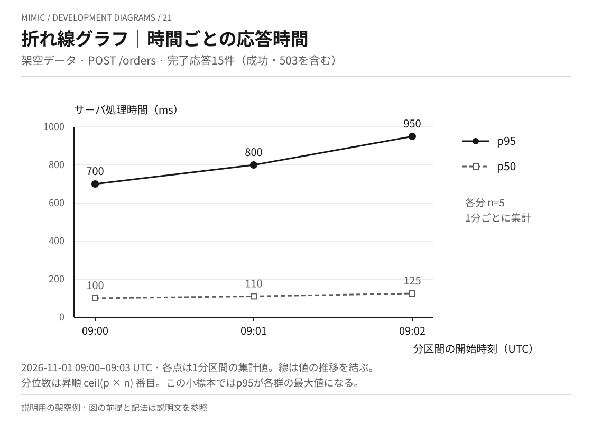
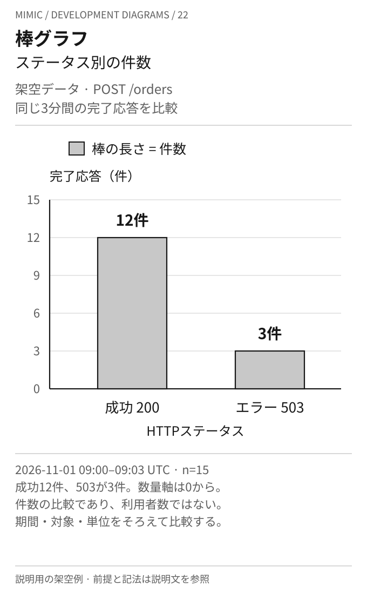
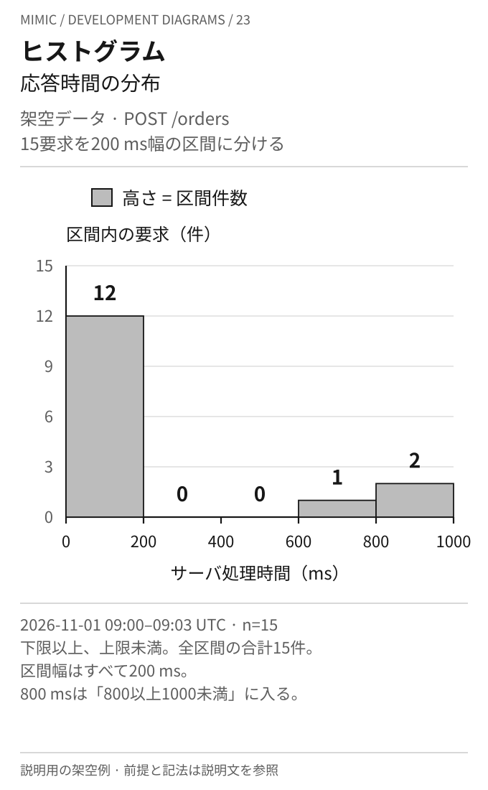
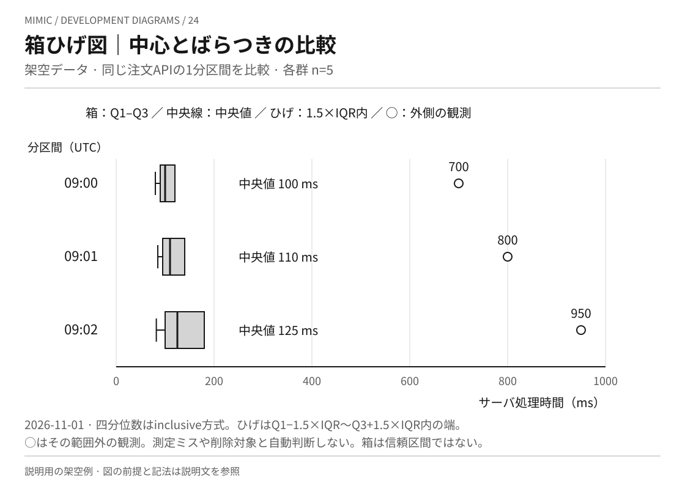
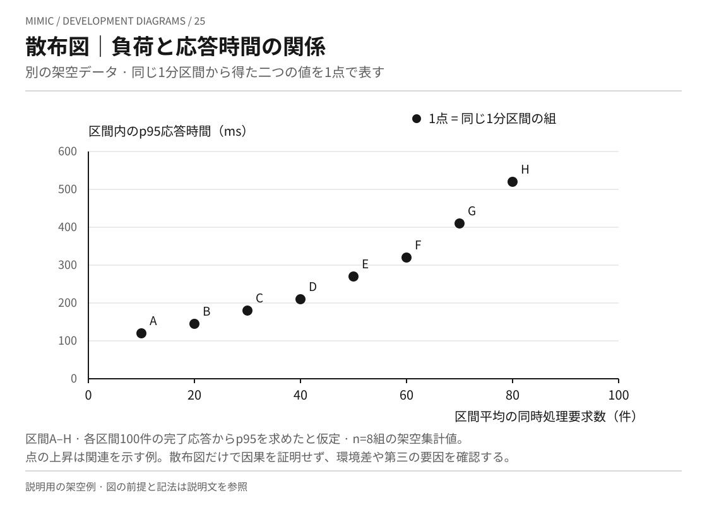
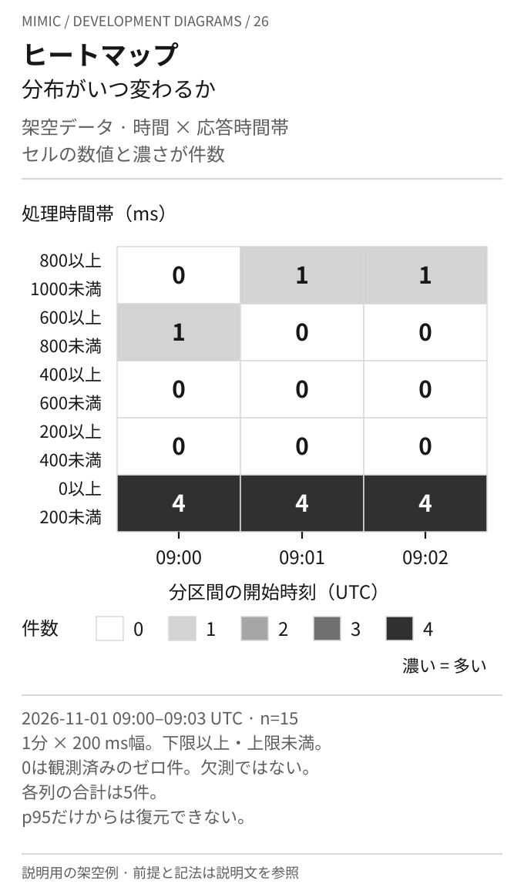
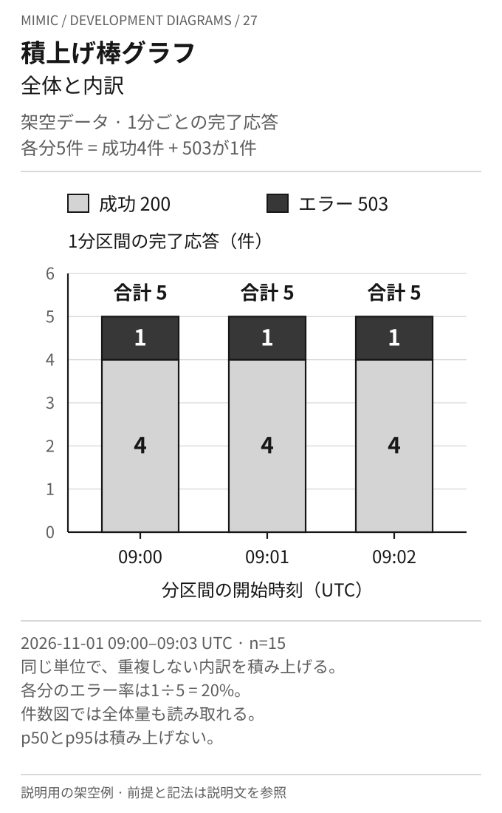
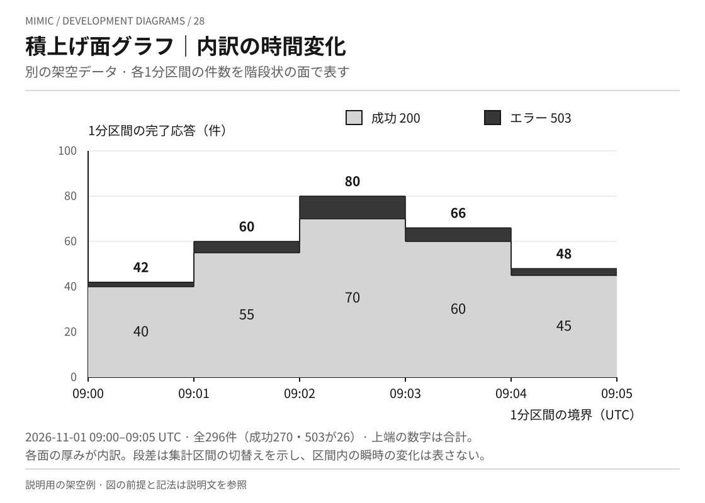

# 統計グラフの作図例

比較、時間変化、分布、関連、内訳という読み取りの違いを、8種類の画像で示します。
すべてMimicが作成した説明用の架空データです。実測、性能改善の証拠、推奨する合格基準ではありません。
図中の値、軸、集計条件を合わせて読みます。図種の定義と注意点は[本文](../KNOWLEDGE.md)、根拠は[出典対応表](../references/sources.md)を参照します。

図21〜24・26〜27は[注文APIの架空計測例](performance.md)の15要求を使います。
対象は2026年11月1日09:00:00 UTC以上09:03:00 UTC未満に完了した`POST /orders`です。
各分5件、成功HTTP 200が4件、HTTP 503が1件で、応答時間は両方を含むサーバ内の処理時間です。
未完了要求、タイムアウト、通信時間、リトライは含みません。小標本の作図例であり、運用上の裾の性能を安定して評価する測定設計ではありません。
図25と図28は別の架空入力です。元の15要求と混ぜて集計しません。

## 21. 折れ線グラフ：時間ごとの応答時間

[画像を開く：折れ線グラフ](chart-line.svg)

用途は、時間に伴う変化や系列同士の推移の比較です。
横軸は各1分区間の開始時刻、縦軸は処理時間のミリ秒です。点は区間の集計値で、線の途中が観測された値とは限りません。
p分位数は値を昇順に並べた`ceil(p × n)`番目とし、各区間のnは5です。この例ではp95が最大値になります。
3点の変化から長期傾向や原因を断定しません。欠測のある実データでは、欠測区間をつないだりゼロで補ったりしないようにします。

## 22. 棒グラフ：分類間の件数比較

[画像を開く：棒グラフ](chart-bar.svg)

用途は、同じ条件で集計した分類間の数量比較です。
横軸はHTTPステータス、縦軸は3分間の完了応答件数です。棒の長さの比が12対3になるよう、数量軸をゼロから描いています。
全体15件に対してエラーは3件ですが、これは要求単位の件数であり、利用者数や利用者ごとの失敗率ではありません。
分類、観測期間、分母の異なる値を同じ意味の棒として並べないようにします。

## 23. ヒストグラム：一つの数量の分布

[画像を開く：ヒストグラム](chart-histogram.svg)

用途は、応答時間など一つの数量がどこへ集中し、どの程度広がるかを見ることです。
横軸はミリ秒、縦軸は区間の件数です。区間幅は200ミリ秒に統一し、下限を含み上限を含みません。
800ミリ秒は800以上1000未満へ入り、度数の合計は15件です。横軸は連続した数量の区間なので、分類の棒グラフのように順番を並べ替えません。
区間幅を変えると見え方も変わります。不等幅の区間や密度を使う場合は、件数の高さと面積の意味を改めて定義します。

## 24. 箱ひげ図：群ごとの中心とばらつき

[画像を開く：箱ひげ図](chart-boxplot.svg)

用途は、複数の群の中心とばらつきを共通尺度で比較することです。
横軸はミリ秒、縦方向には三つの1分区間を並べ、各群のnは5です。
四分位数にはPython標準ライブラリ`statistics.quantiles(..., n=4, method="inclusive")`の方式を使います。
箱はQ1からQ3、中央線は中央値です。IQRはQ3−Q1で、ひげはQ1−1.5×IQR以上Q3+1.5×IQR以下にある観測の最小値・最大値まで伸ばします。
その外側の観測を丸で残します。

| 分区間の開始（UTC） | Q1（ms） | 中央値（ms） | Q3（ms） | ひげの端（ms） | 外側の観測（ms） |
| --- | --- | --- | --- | --- | --- |
| 09:00 | 90 | 100 | 120 | 80〜120 | 700 |
| 09:01 | 95 | 110 | 140 | 85〜140 | 800 |
| 09:02 | 100 | 125 | 180 | 82〜180 | 950 |

遅い観測も軸の中に残すと、この例の箱は短く見えます。丸を測定ミスとして削除したり、箱を信頼区間と読んだりしません。
箱の違いだけで有意差や改善効果を断定することもできません。

## 25. 散布図：二つの量の関係

[画像を開く：散布図](chart-scatter.svg)

用途は、同じ観測単位について記録した二つの数量の関係を見ることです。
これは元の15要求とは別に作成した架空の集計値です。区間A〜Hは同じ環境の連続する1分区間とし、各区間100件の完了応答からp95を得たと仮定します。
入力は次の8組で、元の100件ずつの生データや実験結果を示すものではありません。
横軸は区間平均の同時処理要求数、縦軸は同じ区間のp95応答時間です。

| 区間 | 平均同時処理要求数（件） | p95応答時間（ms） |
| --- | --- | --- |
| A | 10 | 120 |
| B | 20 | 145 |
| C | 30 | 180 |
| D | 40 | 210 |
| E | 50 | 270 |
| F | 60 | 320 |
| G | 70 | 410 |
| H | 80 | 520 |

点が右上がりに並ぶ関係を示していますが、図だけでは因果関係を証明できません。
別の時刻や対象から得た二つの値を組にしたり、図に示していない負荷条件まで外挿したりしないようにします。

## 26. ヒートマップ：時間ごとの分布

[画像を開く：ヒートマップ](chart-heatmap.svg)

用途は、時間と値の区間など、二軸に対応する値の集中を読むことです。
横軸は1分区間、縦軸は200ミリ秒幅の処理時間帯です。セルの数値と濃さが件数を表し、全セル共通でゼロから4件の色尺度を使っています。
各列の合計は5件です。ゼロは観測されたゼロ件で、欠測を意味しません。
これは各分の生の観測値から集計した分布です。各分のp95だけを並べても、このセルの値は復元できません。

## 27. 積上げ棒グラフ：全体と内訳

[画像を開く：積上げ棒グラフ](chart-stacked-bar.svg)

用途は、群ごとの全体量と、それを構成する内訳を同時に見ることです。
横軸は1分区間の開始時刻、縦軸は件数です。下から成功4件、503が1件を積み上げ、合計5件を示しています。
分類は重複せず、同じ単位で加算できます。この例の各分のエラー率は1÷5で20%です。
100%積上げにすれば構成比を比較できますが、全体量の違いは見えなくなるため母数を添えます。
p50とp95のような加算できない値を内訳として積み上げることはできません。

## 28. 積上げ面グラフ：内訳の時間変化

[画像を開く：積上げ面グラフ](chart-stacked-area.svg)

用途は、全体と内訳が時間に沿ってどう変化するかを見ることです。
これは元の15要求とは別の架空入力で、2026年11月1日09:00:00 UTC以上09:05:00 UTC未満の1分区間ごとの件数です。
横軸の時刻は区間境界で、各区間は開始時刻以上・終了時刻未満です。縦軸は1分区間の件数であり、毎秒の瞬時値ではありません。
線形補間を避け、集計値を各区間にわたる階段状の面として描いています。

| 区間（UTC） | 成功200（件） | エラー503（件） | 合計（件） |
| --- | --- | --- | --- |
| 09:00〜09:01 | 40 | 2 | 42 |
| 09:01〜09:02 | 55 | 5 | 60 |
| 09:02〜09:03 | 70 | 10 | 80 |
| 09:03〜09:04 | 60 | 6 | 66 |
| 09:04〜09:05 | 45 | 3 | 48 |
| 全期間 | 270 | 26 | 296 |

下側の面は成功件数、上側の面の厚みはエラー件数、上端は合計件数です。
上側の面は基準線が動くため、エラーの細かな比較が目的なら、その系列を独立した棒や折れ線に分けます。
面の段差は集計区間の切替えであり、実際の要求がその瞬間にまとめて発生したことを意味しません。

[本文に戻る](../KNOWLEDGE.md)
