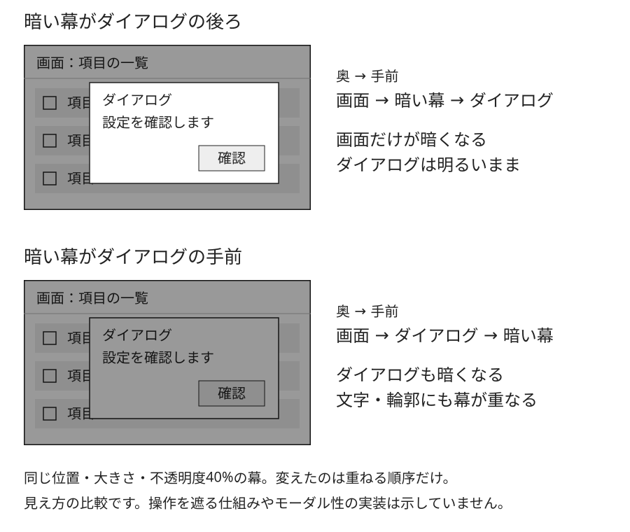

# 幕とダイアログの順序を比べる説明例

## 比較するもの

元の画面、黒い半透明の幕、不透明なダイアログを実際に重ねて描き、幕を挟む位置を比べるMimicの作例です。[本文の三層の説明](../KNOWLEDGE.md)に対応します。

[説明図を大きく開く（SVG）](./layer-order.svg)から、表示と編集に使う図そのものを参照できます。

## 変えることと保つこと

元の画面とダイアログの内容、位置、大きさ、色を同じにします。幕も両段とも画面全体を覆う黒・不透明度40%の面です。変えるのは、幕がダイアログより奥か手前かという順序だけです。

上段ではダイアログの白い面と文字が幕の手前に残ります。下段では幕がその上に重なり、白い面も暗くなります。右側の矢印付きの順序表示と、左側の重ねた絵を対応させて読みます。

## 説明の範囲

色・文字の役割名と値はSVGの説明文に記載した説明用の設定です。製品の推奨配色や、優れたUIを実証する比較ではありません。ボタンも静止画の一部で、背後の操作を遮る仕組みやフォーカス制御を示していません。

[本文](../KNOWLEDGE.md)では幕がかかる範囲と操作対象の違いを、[出典の対応表](../references/sources.md)では合成の規則とモーダルの指針を区別して確認できます。
