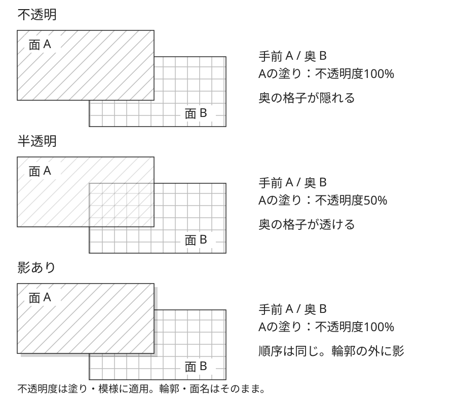

# 二つの面の重なりを比べる説明例

## 比較するもの

格子のある面Bを奥に、斜線のある面Aを手前に置き、不透明・半透明・影ありを比べるMimicの作例です。上段・中段・下段の見え方は、[本文の不透明・半透明・影の説明](../KNOWLEDGE.md)に対応します。

[説明図を大きく開く（SVG）](./layer-comparison.svg)から、表示と編集に使う図そのものを参照できます。

## 変えることと保つこと

各段でA・Bの位置と大きさ、Aが手前という順序を保ちます。Aの塗りと斜線は上段で100%、中段で一まとまりとして50%、下段で100%です。輪郭と面名は三段とも不透明のままです。下段だけAの右下へずらした黒・不透明度17%の影を添えます。

上段ではBの格子がAの輪郭で途切れ、中段では同じ範囲の内側にも格子が残ります。下段では上段と同じ範囲の格子が隠れ、その外側に影が現れます。三段は前後の順序を変えた比較ではありません。

## 説明の範囲

白い台紙上の説明図です。色・文字・影の役割名と値はSVGの説明文に記載し、説明用の仮名・設定としています。ぼかしは加えていません。原典図の転載、製品の推奨配色、影の最適値、読みやすさの実証ではありません。

[本文](../KNOWLEDGE.md)では見え方の理由を、[出典の対応表](../references/sources.md)では合成の規則と作例の範囲を確認できます。
