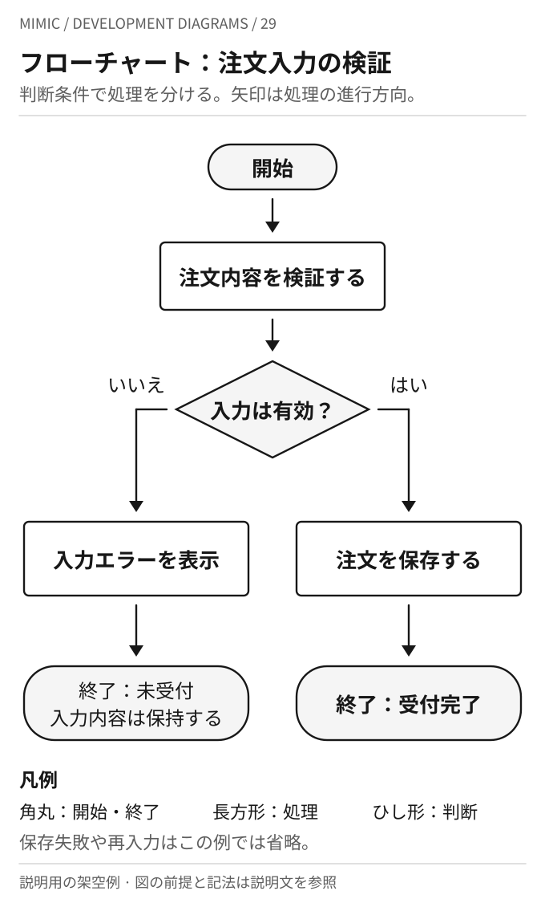
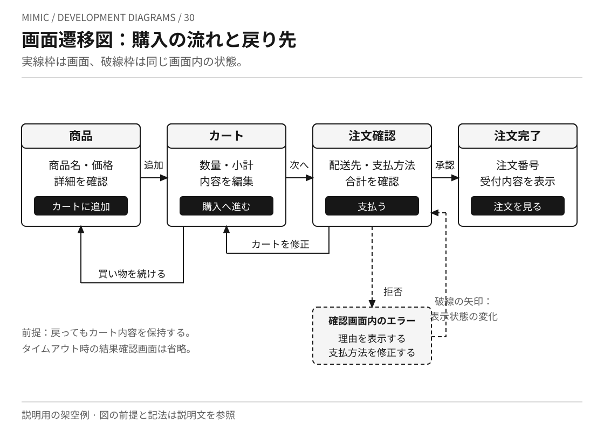
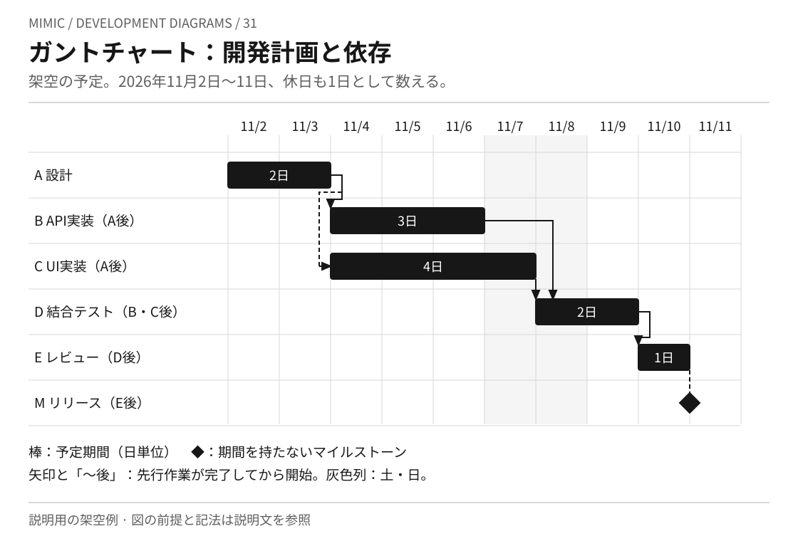

# 手順・画面遷移・開発計画の図

このページは、架空の注文システムを題材にMimicが作成した説明例です。
フローチャート、画面遷移図、ガントチャートの見方を比較します。
これらをUMLの厳密な記法として扱うものではありません。
[UMLの図](../KNOWLEDGE.md)とは、表す対象と記号の意味を区別して読みます。
図は編集できる自己完結のSVGであり、実在サービスの仕様や、開発期間の実績・推奨値ではありません。

## 29 フローチャート：注文入力の検証

[フローチャートの画像を開く](flowchart.svg)

使い所は、単純な処理順序と判断条件を説明するときです。
角丸の枠は開始・終了、長方形は処理、ひし形は判断を表します。
「入力は有効？」から出る二本の線に「はい」「いいえ」を記し、どちらにも終了を置いています。

この例では入力が無効なとき注文を保存せず、入力内容を残すと仮定しています。
エラー後の再入力、保存失敗、同時実行は省略しています。
図の上下の距離は所要時間を表しません。
並行処理の同期などを厳密に説明するときは、UMLアクティビティ図の意味を確認します。

## 30 画面遷移図：購入の流れと戻り先

[画面遷移図の画像を開く](screen-flow.svg)

使い所は、画面の役割、移動のきっかけ、戻る経路を共有するときです。
実線の枠は画面、実線の矢印は画面間の移動です。
商品をカートに加え、注文内容を確認し、支払いが承認されると完了画面へ進みます。
確認画面からカートを修正する経路と、カートから買い物を続ける経路も描いています。

破線の枠は別画面ではなく、確認画面内のエラー状態です。
支払いが拒否された場合は理由を示し、支払方法を修正するものとします。
破線の矢印は同じ画面内の表示状態の変化です。
画面間の移動と、その画面で何を表示・操作できるかを分ける考え方は、[インタラクションデザインの本文](../../interaction-design/KNOWLEDGE.md)に対応します。

戻ってもカート内容を保持することは、この作例の前提です。
タイムアウトは拒否と同義ではありません。結果確認中の表示、再読込、認証、二重送信の扱いは省略しています。
各画面内の配置は役割を示すための略図であり、完成した画面デザインではありません。

## 31 ガントチャート：開発計画と依存

[ガントチャートの画像を開く](gantt.svg)

使い所は、作業期間と先行作業への依存を説明するときです。
横軸の一列は一暦日です。土日も一日として数え、11月7日・8日の背景を灰色にしています。
棒は予定期間、ひし形は期間を持たないリリースのマイルストーンです。
矢印と作業名の「〜後」は、先行作業が完了してから開始する関係を表します。
実線・破線の依存矢印はどちらも同じ意味で、経路を追いやすくするために描き分けています。

| 作業 | 予定日 | 日数 | 先行条件 |
| --- | --- | --- | --- |
| A 設計 | 11月2日〜3日 | 2日 | なし |
| B API実装 | 11月4日〜6日 | 3日 | Aの完了 |
| C UI実装 | 11月4日〜7日 | 4日 | Aの完了 |
| D 結合テスト | 11月8日〜9日 | 2日 | BとCの完了 |
| E レビュー | 11月10日 | 1日 | Dの完了 |
| M リリース | 11月11日開始時点 | 期間なし | Eの完了 |

棒の右端は、最終日の翌日の開始境界に合わせています。
たとえば設計の2日間は11月2日開始から11月4日開始までです。
この日程は説明のために作成した予定であり、実績、所要工数、担当者の稼働率、納期の確実さを示しません。
休日を除く日程へ変更する場合は、カレンダーと期間の数え方を合わせて変更します。

## 関連する説明

[開発資料の図とグラフを選ぶ](../../../topics/development-diagrams.md)では、図の用途と作図手段を比較できます。
フローチャートとガントチャートの構文については、同案内が参照するMermaid公式資料を確認します。
このページのSVGは、その公式サンプルを複製したものではありません。
