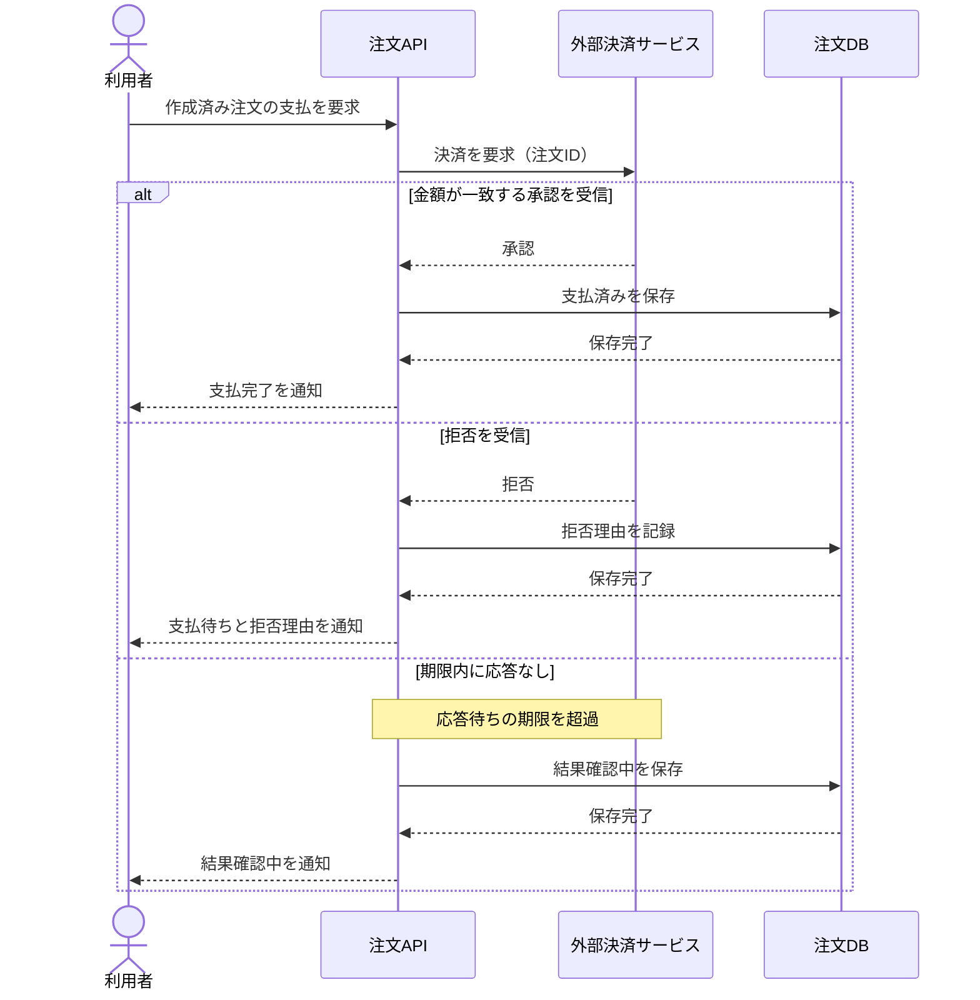
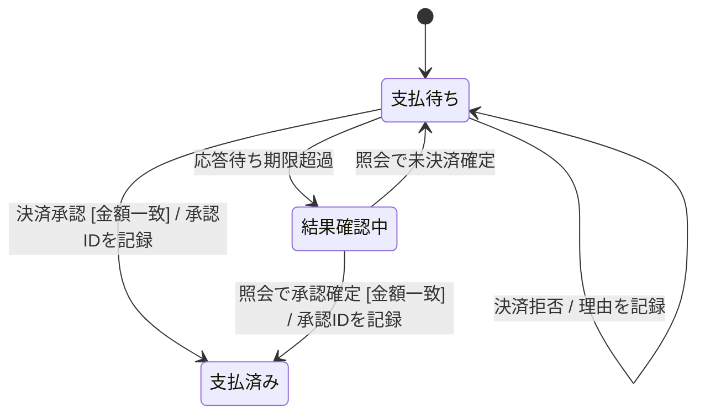

# 注文の決済要求と状態遷移

[UMLの本文](../KNOWLEDGE.md)に対応する、Mimicが作成した架空の例です。
一回の決済要求の相互作用と、一つの注文の支払状態の違いを説明します。
本番の決済設計、性能の実測、完全な状態機械の検証結果ではありません。

このページのコードはMermaid用です。MimicのPagesではソースコードとして表示し、図の自動描画は行いません。
図にする場合は対応するMermaid環境で描画し、対象環境の版と表示結果を確認します。
図を表示しなくても、以下の文章で流れと対象範囲を確認できます。

## 決済要求のシーケンス

開始時点では注文が作成済みで、支払状態は「支払待ち」とします。
利用者が支払操作を行うと、注文APIが外部決済サービスへ要求します。
要求した金額と一致する承認なら「支払済み」、拒否なら「支払待ち」のままです。
応答が期限内に得られなければ「結果確認中」にして利用者へ伝えます。
タイムアウトは決済の拒否を意味しないため、この例では両者を分けています。

この例では実線の矢印を要求、破線を応答として読んでいます。
この凡例は作例の読み方であり、Mermaidの矢印からUMLの同期・非同期の意味全体を保証するものではありません。
縦方向の間隔は所要時間を示しません。
金額の不一致、DBへの保存失敗、重複した支払操作、遅延応答と照会処理の競合は省略しています。
それらを設計する際は、別の分岐・シーケンスと整合する状態遷移を追加します。

## 注文の支払状態

同じ相互作用を状態の側から見ると、承認・拒否・タイムアウトという結果によって、遷移先が異なります。
「結果確認中」では結果照会の確定通知を待つものとし、追加の支払要求はこの例の対象外です。
発送や返金の状態は含めません。下図に終了点がないのは、注文全体の終了を定義していないためです。

`決済承認`がトリガー、`[金額一致]`がガード、`承認IDを記録`が遷移時の処理です。
ここではラベルで意味を説明しており、Mermaidが条件式を実行して妥当性を検査するわけではありません。
「結果確認中」は対象の状態であり、「結果を照会する」という処理そのものではありません。
この部分図にない取消や返金の遷移が、製品全体で禁止されているとは解釈しません。
