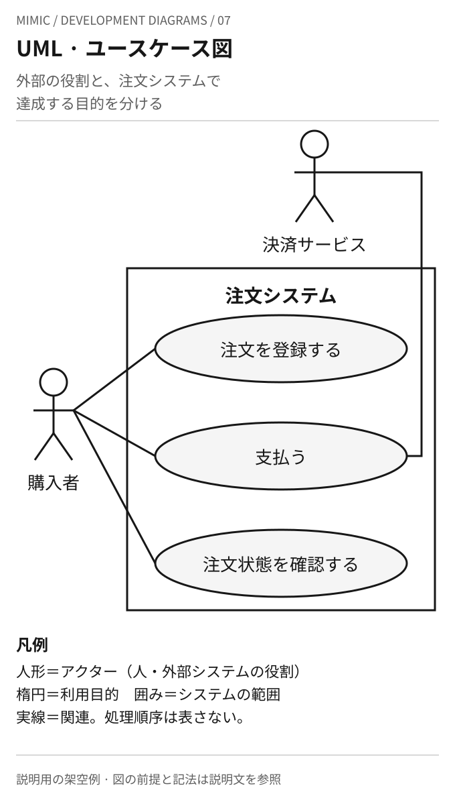
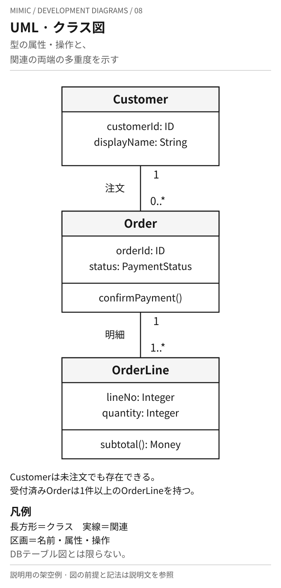
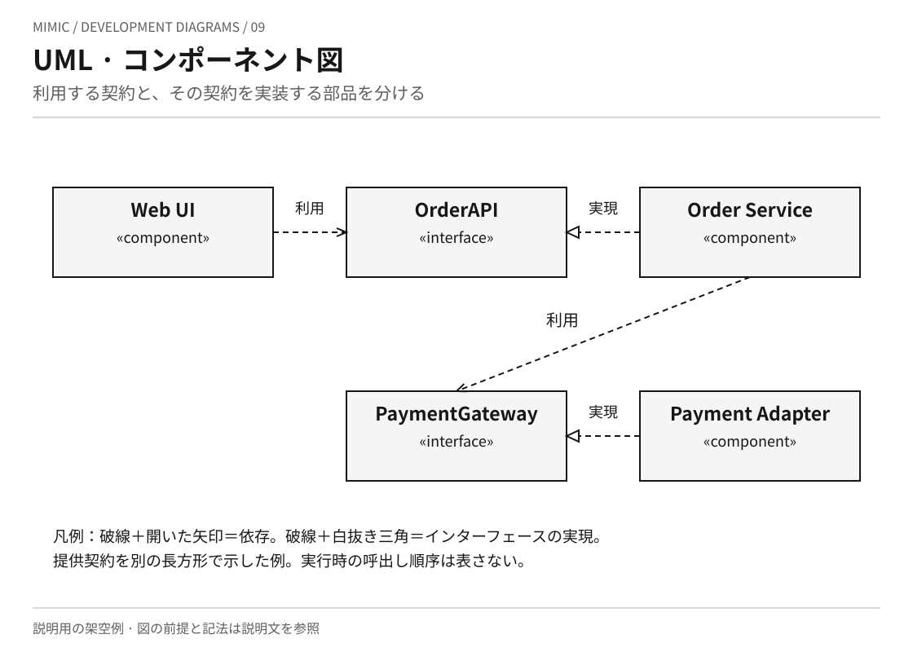
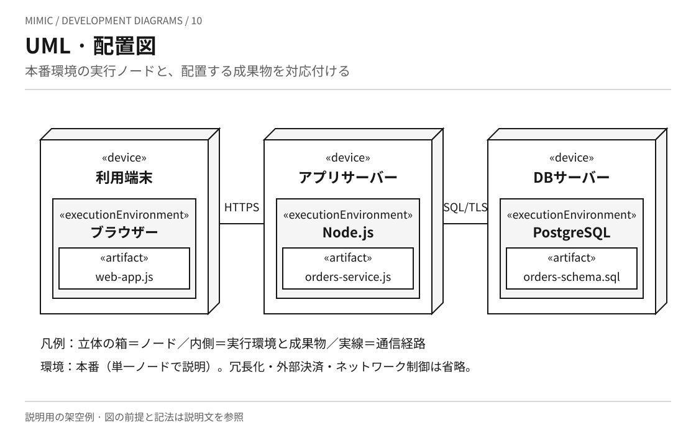
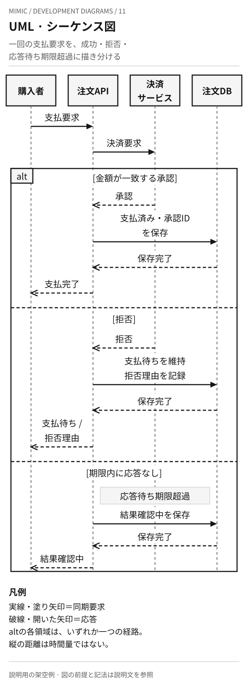
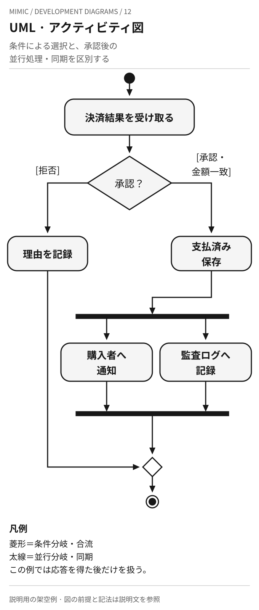
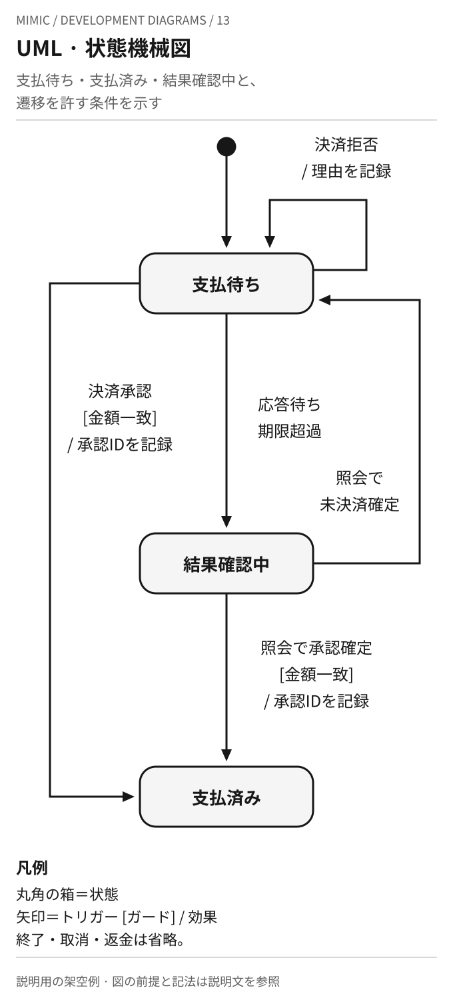

# UMLの図を画像で見比べる

[UMLの本文](../KNOWLEDGE.md)で紹介した七つの図を、架空の注文システムで描き分けたMimicの作例です。
公式資料の図を複製したものではなく、記法と説明対象の違いを示します。図がそろうことは、設計の完全性や実装の検証済みを意味しません。
支払の相互作用と状態の前提は、[決済要求と状態遷移の例](order-lifecycle.md)と共通です。
図ごとに扱う範囲を限定しています。全図を組み合わせた完成仕様ではありません。

## 07 · ユースケース図

[画像を開く](uml-use-case.svg)

要求整理で、外部の役割が対象システムを使って何を達成するかを確認する図です。
人形は人に限らず、外部システムが担う役割も表します。楕円は目的、囲みは対象システムの範囲です。
関連線は処理順序ではありません。認証、権限、成功条件、例外の詳細は文章のシナリオで補います。

## 08 · クラス図

[画像を開く](uml-class.svg)

型の責務、属性、操作、静的な関連を検討する図です。
この例では顧客は未注文でも存在でき、受付済みの注文は明細を一件以上持ちます。関連線の両端の多重度を読みます。
`confirmPayment()`は注文の操作、`subtotal()`は明細の操作です。表示した操作の実装やDBテーブルへの対応は定義していません。
継承・集約・可視性の記号を省き、属性型の詳細や整合性を守る条件も別の仕様へ残しています。

## 09 · コンポーネント図

[画像を開く](uml-component.svg)

部品と、その連携契約を説明する図です。`component`は部品、`interface`は契約を表します。
破線に開いた矢印は利用側から契約への依存、破線に白抜き三角は実装する部品から契約への実現です。
提供するインターフェースを独立した長方形で示す表現を使っています。要求・提供の接続を棒と丸で示す表現は使っていません。
依存の向きだけから、実行時の呼出し順序・応答・タイムアウトを読み取らないようにします。

## 10 · 配置図

[画像を開く](uml-deployment.svg)

実行場所と配置物を対応させる図です。外側のノード、内側の実行環境、その中の成果物を読み分けます。
例では利用端末とアプリサーバーがHTTPS、アプリサーバーとDBサーバーがSQL/TLSで通信する想定です。
SQLファイルはDBスキーマを導入する成果物として示しており、常駐プロセスを意味しません。
本番環境を単一ノードずつで説明し、冗長化、外部決済、ネットワーク制御、証明書や配備の手順は省いています。

## 11 · シーケンス図

[画像を開く](uml-sequence.svg)

一回の支払要求を参加者間のやり取りとして追う図です。開始時点で注文は作成済み、支払状態は「支払待ち」です。
実線と塗り矢印を同期要求、破線と開いた矢印を応答として表し、実行区間を表す細長い矩形は省略しています。
`alt`の三領域はそれぞれ条件が異なる経路です。上から全領域を連続実行する意味ではありません。
タイムアウトは拒否と区別し「結果確認中」とします。線の縦の長さは所要時間を表しません。
金額不一致、保存失敗、重複要求、遅延応答の競合、結果照会の詳細はこの図の対象外です。

## 12 · アクティビティ図

[画像を開く](uml-activity.svg)

条件による選択と、並行処理を含む手順を説明する図です。ここでは決済応答を得た後を扱います。
上の菱形は条件による経路選択、下の菱形は選ばれた経路の合流です。合流は両経路を待つ意味ではありません。
二本の太線は並行分岐と同期です。承認時には購入者通知と監査ログ記録を並行して行い、両方が終わるまで先へ進みません。
この並行化は記法を説明するための仮定で、推奨実装ではありません。通知失敗時の再試行、未応答、金額不一致は省略しています。

## 13 · 状態機械図

[画像を開く](uml-state.svg)

一つの注文の支払状態が、どの出来事と条件で変わるかを説明する図です。
遷移ラベルは「トリガー [ガード] / 効果」として読みます。「結果確認中」は対象の状態であり、結果を照会する処理そのものとは区別します。
決済拒否の自己遷移でも理由を記録します。状態が同じであることは、何も処理しないこととは異なります。
「結果確認中」からは照会で確定した結果により遷移します。追加の支払要求、取消、返金、注文全体の終了は図示していません。

[UMLの本文に戻る](../KNOWLEDGE.md)
